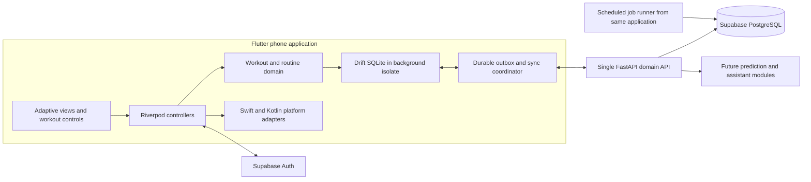

# Technical architecture

Planning baseline: 2026-10-12. This document describes the intended architecture; a scoped Phase 0 foundation now exists, with evidence in [IMPLEMENTATION.md](IMPLEMENTATION.md). No production application exists yet. Product scope is governed by [PRODUCT.md](PRODUCT.md), phases by [ROADMAP.md](ROADMAP.md), and detailed synchronization by [SYNC_PROTOCOL.md](SYNC_PROTOCOL.md).

## Decisions and release boundaries

Daily Motion targets adult strength and hypertrophy athletes, initially in India with English interfaces. A lean team of 1–3 engineers will build one polished phone application for iOS 16+ and Android 10+. The free MVP includes routines, offline workouts, advanced but restrained set logging, basic duration/distance entries for holds/carries, history, and basic progress. Multiweek program editing, imports, health integration, predictions, conversational AI, and billing ship later.

Use Flutter, Riverpod, and Drift SQLite on mobile; Python FastAPI, Pydantic 2, SQLAlchemy 2, psycopg 3, and PostgreSQL on the backend. Supabase supplies managed PostgreSQL and authentication. The API remains a modular monolith. These choices reduce operating work and preserve explicit workout-domain boundaries.

Flutter offers a shared mobile implementation and precise control of training controls, animation, typography, and charts. Separate SwiftUI/Compose applications or Kotlin Multiplatform with two native interfaces would require considerably more UI engineering. React Native is viable, but provides no decisive advantage for this custom interaction-heavy product. Flutter still requires native adapters and deliberate platform behavior; Cupertino-looking widgets alone do not establish iPhone quality. Review platform choices after a real-device prototype, before building the full logger. [Flutter platform integration](https://docs.flutter.dev/platform-integration)

FastAPI is chosen for typed interfaces and a practical path to Python statistical code, rather than because Python must become a collection of services. A Supabase-only client would simplify initial CRUD but make historical invariants, conflict handling, and future assistant writes harder to enforce uniformly. All training mutations therefore cross the same API domain boundary.

## System and repository shape

The proposed monorepo contains `apps/mobile/`, `services/api/`, `contracts/`, `infra/`, and `docs/`. A future `ml/` directory contains experiments, dataset manifests, and training entrypoints when reproducible ML experiments actually begin. Deterministic Phase 3 rules remain internal mobile/API modules. Do not create empty services or a root package ecosystem to anticipate reuse.

Mobile features contain presentation/controllers, repositories, and domain functions where behavior warrants them. Shared design components remain internal to the application until another real consumer exists. Widgets own layout and animation; they do not calculate progression, mutate sets directly, or implement synchronization. Riverpod wires dependencies and observes repository streams. Avoid separate use-case classes for trivial getters. [Flutter architecture recommendations](https://docs.flutter.dev/app-architecture/recommendations)

The API organizes catalog, identity/profile, routines, workouts, synchronization, and analytics into modules. Later prediction and assistant modules call those domain interfaces. Shared transaction and authorization infrastructure does not become a generic abstraction that hides workout lifecycle rules. Generate mobile transport models/client code from checked OpenAPI contracts; Python and Dart numerical behavior shares versioned parity fixtures rather than a fictitious cross-language executable package.

## Local persistence, history, and synchronization

Drift is the mobile source of truth. Run its database in a background isolate, coordinate query streams through that instance, and version/test every local migration. SQL work cannot block the rendering isolate. [Drift isolates](https://drift.simonbinder.eu/isolates/), [Drift migrations](https://drift.simonbinder.eu/migrations/)

A validated local command atomically updates the working projection, advances its local sequence, and appends an outbox entry. The interface acknowledges durable local persistence; upload runs independently. The p95 target for a durable set save is at most 100 ms on the qualification device cohort. Network latency never participates in that path.

Every workout-session command checks and advances the session aggregate revision, including child-set edits. Payloads contain small commands; normalized rows and append-only changed-observation history preserve corrections without serializing the entire session for each set. Templates and future program versions are snapshotted independently of performed history. Explicit personal-data deletion overrides historical retention. See [DATA_MODEL.md](DATA_MODEL.md).

Maintain separate acknowledged server shadow, working projection, and local sequence. Each root's outbox runs sequentially. The first command retains its original acknowledged base; later commands use their own predecessor's accepted revision. Freeze envelopes before sending. External pulls cannot silently rebase pending commands or replace their working projection; a late acknowledgement cannot downgrade a newer shadow.

The API atomically validates ownership/revision, applies a command, records historical changes, stores its idempotency receipt, and emits a change batch. Account deletion and mutations share the owner lock and recheck active state/generation before effects. A transactionally locked per-user counter orders feed commits. A PostgreSQL sequence alone is unsafe as a pull cursor because allocation and commit order can differ. The same committed visibility fence bounds consistent prediction reads; pre-commit timestamps cannot establish causal feature availability. [PostgreSQL sequence behavior](https://www.postgresql.org/docs/current/functions-sequence.html)

Bootstrap materializes bounded pages from one short repeatable-read snapshot at feed position B. HTTP pagination reads the materialized pages, never an open database transaction. Clients stage and validate all pages before activating the shadow and cursor; pending roots and local-only creations survive. Retired UUIDs and content-free receipts prevent replay resurrection after feed pruning. Detailed wire shape, limits, and resolution behavior live in [SYNC_PROTOCOL.md](SYNC_PROTOCOL.md).

There is one active workout per device. Distinct offline workout IDs remain distinct. Simultaneous edits to the same session may conflict, including disjoint edits; no live handoff is promised. Logging continues locally while that root awaits explicit resolution. Rest timers derive from persisted anchors, with monotonic time where available and uncertainty after clock changes; background execution is unnecessary for correctness.

## Backend, identity, and infrastructure

First account verification requires connectivity. Email OTP through Supabase Auth is the MVP sign-in method, using custom production SMTP and secure platform token storage. Previously verified local-owner access survives expired access tokens and failed refresh. Cloud authentication failure pauses synchronization. Explicit sign-out locks the owner database while retaining its outbox; another account never acquires those operations. Account deletion immediately disables cloud access before cleanup jobs. See [SECURITY.md](SECURITY.md).

Training tables live in a private schema, with the Data API disabled or denied access to that schema. The API uses a non-owner database role without `BYPASSRLS`; tenant identity is set transaction-locally from a verified user. Owner checks, composite owner-aware foreign keys, and RLS provide separate defenses. Migration/admin credentials are isolated. Direct mobile table writes and LLM SQL access are prohibited.

Use Supabase's exact Mumbai region `ap-south-1` and Cloud Run `asia-south1`. The initial API uses its managed TLS `run.app` endpoint; avoid early custom-domain/load-balancer infrastructure. These are latency and operating defaults, not blanket residency guarantees. [Supabase regions](https://supabase.com/docs/guides/platform/regions), [Cloud Run locations](https://docs.cloud.google.com/run/docs/locations)

Use a small bounded database connection pool and Cloud Run maximum-instance limits. If transaction pooling is selected, disable automatic prepared statements and keep tenant settings inside explicit transactions. Migrations use an appropriate dedicated connection. Alembic owns application schema migrations; Supabase configuration manages its hosted auth/platform settings. [Supabase connection guidance](https://supabase.com/docs/guides/database/connecting-to-postgres)

Durable jobs, when required for export, deletion, or recomputation, use leased PostgreSQL jobs with retry limits and a scheduled Cloud Run job running the same codebase. Jobs are idempotent, renew/expire leases, and expose terminal failure. Under the owner guard, ordinary effect publication requires an active account; narrow erasure workers permit deleting state for cleanup only. Do not rely on API-process background tasks, or add Redis, Kafka, Kubernetes, vector storage, or a feature store.

MVP analytics run locally. Later cloud reports include source revision and freshness. Phase 3 deterministic baselines run locally with a server mirror and cross-language parity fixtures; learned inference initially runs server-side in the same application. Model artifacts use private storage and versioned manifests. A separate runtime or learned on-device inference requires measured benefit. The Phase 4 assistant reads authorized domain tools and proposes confirmed future-plan writes; it cannot commit active/historical workout changes. See [PREDICTION_ENGINE.md](PREDICTION_ENGINE.md) and [CHATBOT_ARCHITECTURE.md](CHATBOT_ARCHITECTURE.md).

## Operations and platform integration

Development uses local services/synthetic fixtures; staging and production use separate Supabase projects, auth users, secrets, storage, and API deployments. CI runs Python/contracts and Android checks on Linux, iOS checks on macOS, and requires physical-device release qualification. Windows development alone cannot produce an iOS release.

Structured telemetry measures local-save latency, sync age/conflicts/retries, request latency, job failures, and crash-free sessions. Minimal product events measure routine creation, workout completion, and return usage without exercise/load/health payloads; disclose collection and retention. Logs exclude tokens, set payloads, notes, health records, and assistant prompts. A crash-reporting provider is selected behind a narrow adapter and recorded in an ADR before deployment. Feature flags disable optional future services on failure; they never disable core offline logging. Alerts and restoration drills are release work, not post-launch cleanup.

Native adapters cover notifications, haptics, secure storage, platform navigation, and later HealthKit/Health Connect. Android predictive back and iOS navigation/keyboard behavior receive explicit tests. Health and wearable work follows [HEALTH_INTEGRATIONS.md](HEALTH_INTEGRATIONS.md); OS background jobs are best effort and never prerequisites for saving a workout.
