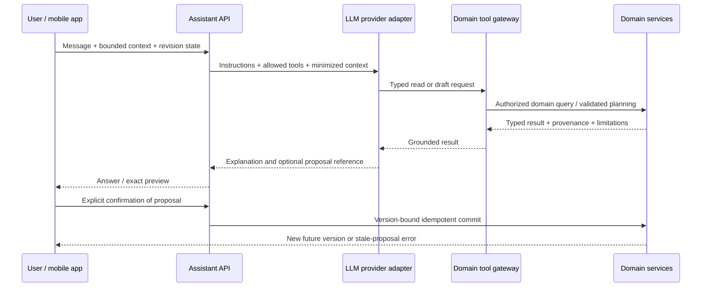

# Conversational assistant architecture

Status: planned; 2026-10-12. Phase 4 follows the offline product and deterministic engine. No chat interface, LLM dependency, or assistant tables ship in MVP. The assistant is an interface to Daily Motion's training systems, with boundaries defined by [API.md](API.md), [SECURITY.md](SECURITY.md), and [PREDICTION_ENGINE.md](PREDICTION_ENGINE.md).

## Product role and limits

The assistant helps users understand training history, inspect progress, select an existing planned session, and draft useful future changes. It sits in training and history contexts as well as a conversation surface. It must not become a collection of unrelated AI features or interrupt set logging.

| User request | Grounded behavior |
| --- | --- |
| “What should I train today?” | Read routine/program schedule and recent completed sessions; explain available options |
| “What weight should I bench?” | Request an eligible prediction/recommendation; display its value, evidence, and limitations |
| “Why has my bench stopped progressing?” | Retrieve comparable trends and possible-plateau evidence; explain hypotheses without claiming causality |
| “I only have 35 minutes” | Draft a constrained future-session/routine option; preserve required priorities and show estimated-duration limitations |
| “Replace this exercise” during a workout | Suggest catalog-compatible options; user applies a choice through the normal picker |
| “Adjust my next four weeks toward hypertrophy” | Draft a new future program version through domain planning tools; preview before confirmation |
| “What did I do last time I trained chest?” | Query dated workout records with catalog-mapping limitations and source references |

The LLM handles language, intent, explanation, and tool orchestration. It never invents numerical performance predictions or analytics, decides authorization, accesses SQL, commits historical edits, or directly changes an active workout. It does not diagnose injuries, prescribe treatment, infer medical clearance, or claim an abnormal session proves illness. Numerical draft prescriptions are produced and validated by deterministic planning tools using approved policy and user constraints, not free-form LLM arithmetic.

## Infrastructure and request lifecycle

Use a provider adapter inside the modular FastAPI application. Provider selection is deferred until quality, latency, cost, regional processing, retention, and contractual requirements can be evaluated. Do not adopt an agent framework, separate orchestration service, or vector database by default. Domain services remain the same ones used by ordinary mobile controls.

The server supplies trusted identity and authorizes every tool call. `user_id` is not a model-selectable argument. Per-request tool/latency/token budgets bound loops and cost. Provider failures return a recoverable assistant error; logging, timers, and local records continue. Offline users can inspect their records, but chat orchestration and server commits require connectivity. Cached messages disclose their freshness.

## Tool and permission contract

Read tools cover bounded workout/exercise history, catalog lookup, program/routine versions, precomputed analytics, and prediction requests. Examples are `get_recent_workouts`, `get_exercise_history`, `get_training_balance`, `get_program_schedule`, and `get_prediction`. Tools accept typed filters and limits; they do not accept arbitrary query languages, unrestricted URLs, code, or SQL.

Draft tools such as `draft_future_routine_change` and `draft_future_program_change` accept typed goals and constraints. A domain planner calculates values, enforces supported exercises/equipment, checks volume/progression bounds, and returns a proposal. Insufficient information returns questions or unavailable guidance rather than an invented training plan.

All results include source references, revisions, freshness, units, missing inputs, and limitations where relevant. Predictions use the exact shared envelope in [PREDICTION_ENGINE.md](PREDICTION_ENGINE.md). Tool errors are structured and safe for display; authorization failures do not reveal another user's resource existence.

Phase 4 permits read operations and confirmed writes to **future routine/program versions only**. It excludes active-session commits, historical workout edits, account deletion/export execution, billing, permission changes, health reads, and external messaging. Active substitutions remain advisory and use the normal user-operated picker. Ordinary UI actions retain their usual domain validation and history provenance.

## Confirmation, concurrency, and audit

A draft is not a write. The proposal contains the exact structured diff, affected aggregate IDs, cloud base revisions, relevant local sequence, actor, expiry, and diff hash. The mobile preview makes exercise, set, rep, load, and scheduling changes understandable. Confirmation is an explicit user action on that preview. A dedicated authenticated UI path records the event and issues a short-lived server capability bound to owner/proposal/diff; that path is excluded from the model's tool allowlist. No confirmation-signing secret is embedded in mobile or model context. A tool cannot self-confirm.

The mobile client validates local freshness; the server cannot observe unsynced edits. Immediately before dispatch, a short SQLite transaction rechecks each affected root's `local_seq`, dirty drafts and empty outbox, then persists a confirmation intent and durable reservation for those future-plan roots. Serialize local edits/sync projection installation for those reserved roots until the outcome is reconciled; active workouts and unrelated roots remain usable. Never hold a database transaction across the network.

The server verifies ownership, current write policy/required consent, exact diff/hash, expiry, current cloud revision and idempotency. An expired or explicitly invalidated proposal (for example supporting-history deletion/correction or disabled planning policy) requires a fresh preview. Newly logged unrelated work need not invalidate every plan; show its evidence cutoff. Other devices' offline edits remain unobservable and can later conflict safely. A changed target or missing local validation cannot silently rebase the proposal.

The commit uses one stable idempotency identity. A timeout is an unknown outcome, not cancellation: preserve the reservation across restart and query/retry its receipt before applying authoritative state and releasing it. Do not silently dispatch a never-sent assistant commit later. For prolonged uncertainty, the user may preserve a separately labeled new local plan branch; never overwrite the reserved original. User cancellation after dispatch cannot claim rollback without an authoritative result. Undo after known success creates a new confirmed future version.

The audit record captures trusted actor, conversation/action IDs, tool/schema version, proposal hash, referenced revisions, confirmation event, applied version, outcome, and reason codes. Payload retention is minimized and separated from operational logs. Undo creates another valid future version; it does not rewrite the original action history. See [DATA_MODEL.md](DATA_MODEL.md) and [SYNC_PROTOCOL.md](SYNC_PROTOCOL.md).

## Context, retrieval, and memory

Construct context from the current surface, explicitly selected routine/program, bounded recent records, user-confirmed preferences, and typed analytics. Describe acknowledged server history and local unsynced state separately. Server tools cannot claim to incorporate pending sets they have not received. Capture owner erasure epoch with evidence and recheck before storing/publishing derived turns; discard/requery stale work after deletion. Expose stale evidence and offer sync/requery rather than silently mixing incompatible revisions.

Start with SQL-backed domain retrieval and compact typed summaries. No generic document corpus or vector search is needed for launch. Catalog mappings and exercise notes are data, never instructions. If later semantic retrieval improves a measured task, it still returns ownership-filtered records with provenance and bounded retention.

Conversation memory supports continuity but cannot become hidden authority. Store user-confirmed training preferences separately from generated summaries; give users edit/delete controls. An assistant inference about an injury or preference is not automatically durable memory. Summaries record their source/version and are invalidated when referenced data is corrected or deleted. Training-specific memory links actual records and accepted program versions rather than inventing an additional workout history.

[SECURITY.md](SECURITY.md) owns retention: redacted operational logs default to 30 days; transcripts to a rolling 90 days with earlier user deletion; confirmed preferences remain until removed or account erasure. Live deletion targets seven days and backup expiry at most 35 days, subject to the documented provider review. Audits and summaries follow the same deletion boundaries; retention is not extended merely because a record supported an AI explanation.

## Grounding, injection, and health boundaries

User notes, custom exercise names, imported text, previous assistant responses, and tool-returned free text are untrusted. Clearly delimit them and keep tools on an allowlist. Validate every tool argument and output; enforce authorization and policy downstream. Prompt instructions alone do not prevent misuse. [OWASP's excessive-agency guidance](https://genai.owasp.org/llmrisk/llm062025-excessive-agency/) supports limiting permissions and autonomy, and [its prompt-injection guidance](https://genai.owasp.org/llmrisk/llm01-prompt-injection/) explains why retrieval does not remove the threat.

Answers distinguish observations, calculated results, supported predictions, and uncertain hypotheses. Personalized numerical results render from validated structured tool fields/cards referenced by result ID, not a free-form model-authored number. Verify result ownership, task, field and freshness before rendering; unsupported numerical claims trigger a conservative response rather than a substitute guess. Tool-sourced numbers retain units and provenance; unavailable predictions remain unavailable. No estimate is promoted to a measured PR. The assistant can explain general training concepts but cannot override planning constraints, safety boundaries, or reported pain. Concerning health questions receive limited general information and appropriate professional-care guidance without diagnosis.

Imported health information and derived health signals are excluded from third-party LLM context. Population model-training consent is independent of using chat. Minimize transmitted training data, prohibit unrelated identifiers and secrets, and select a provider only after retention/training-use controls are acceptable. See [HEALTH_INTEGRATIONS.md](HEALTH_INTEGRATIONS.md).

## Qualification and operations

Tests cover unauthorized/cross-user tools, injection in notes, fabricated numeric answers, unsupported predictions, excessive tool loops, malicious proposal diffs, expired confirmations, local/cloud conflicts, duplicate commits, provider outages, and deletion-driven memory invalidation. Use a fixed grounded-question suite and inspect tool correctness separately from conversational quality. Red-team confirmed-write paths before enabling them.

Observe latency, budget use, tool success, abstention, stale proposals, grounding failures, and user correction rates without logging raw sensitive content. Roll out read-only first, then future-version proposals behind separate flags. Disable writes independently from reads; disabling the assistant never affects workouts. Architectural or permission changes require [DECISIONS.md](DECISIONS.md); release gates live in [TESTING.md](TESTING.md).
