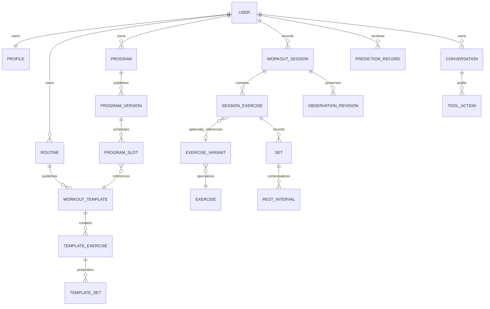

# Data model

Status: accepted planning baseline. Updated: 2026-10-12. A scoped Phase 0 schema is now implemented; [IMPLEMENTATION.md](IMPLEMENTATION.md) records its coverage and limitations. The complete domain model below remains the implementation target.

This document owns domain vocabulary, measurement semantics, relationships, and historical retention rules. [SYNC_PROTOCOL.md](SYNC_PROTOCOL.md) owns synchronization. [API.md](API.md) owns transport examples. A future entity described here is not a requirement to create an unused MVP table.

## Modeling principles

Use normalized PostgreSQL tables and a corresponding SQLite projection for offline training. Keep current state convenient to query, with append-only revisions for historically meaningful changes. This is not full event sourcing: loading a workout must not require replaying its entire history.

- Client-generated UUIDv4 identifiers identify user-created aggregates, sessions, exercises within sessions, sets, and mutations before connectivity exists. IDs never establish chronology.
- Ownership comes from authenticated identity, never a request's `user_id`. Private parent/child relationships use owner-scoped foreign keys so an owned set cannot reference another user's session.
- Each mutable aggregate has an integer `server_revision`. Every child change inside a workout advances the session's revision. Per-aggregate local `local_seq` and pending changes are separate from server revisions.
- Record `occurred_at`, `recorded_at`, and `accepted_at` where meaningful. These mean the reported event time, local recording time, and server acceptance time. Store UTC instants plus the applicable IANA timezone/local-date context. Device clocks are not trusted for conflict ordering.
- Null means unknown or not recorded. It does not mean zero, failure, no fatigue, or no remaining reps.
- Prescriptions and observations are separate. A suggested or prefilled value is not an actual completed set.
- Historical revisions survive corrections. Explicit permanent workout/data deletion and account erasure purge personal payloads and derived eligibility; minimal synchronization metadata can survive ordinary entity deletion to prevent resurrection.

## Identity, ownership, and catalog

| Entity | Important fields and relationships | Availability |
|---|---|---|
| `users` | `id` matches the Supabase Auth subject; account state `active/deleting`; created/deletion-request timestamps. The app owns account state, not auth-provider password/token tables. | MVP |
| `profiles` | Owner; display name optional; unit preference; effort preference `rir/rpe`; timezone; goals and available equipment optional. One profile per user. Date of birth, sex, and medical history are not required for logging. | MVP |
| `devices` | Owner; installation ID; platform; supported contract version; last successful sync. Device identity is an audit hint, not authentication. | MVP |
| `exercises` | Stable movement identity; public or user-owned; authored description; archived status. Private custom exercises never become globally visible automatically. | MVP |
| `exercise_variants` | Stable comparability identity: movement, equipment/setup, rep convention, measurement kind, loading basis, relevant range-of-motion/technique attributes. | MVP |
| `exercise_catalog_revisions` | Immutable definition revision, source/license, display name, semantics and instruction version. Material semantic changes create a new variant; spelling corrections may create a new definition revision. | MVP |
| `muscles` | Small curated taxonomy with stable IDs. Avoid free-text muscle names in analytic joins. | MVP catalog |
| `exercise_muscles` | Variant/revision to muscle; role `primary/secondary`; mapping version and source. Counts are training-volume estimates, not precise stimulus measurements. | MVP catalog; richer analytics Phase 2 |
| `equipment` | Equipment type and loading capability. User availability and increments can be supplied separately. Machine identity/setup is optional but creates a comparability boundary when recorded. | MVP; detailed inventories later |

Store a bounded catalog with versioned, licensed or first-party content. Downloadable media is optional; do not make video playback necessary to start a cached workout. Archive catalog entries instead of rewriting observations that used them. A session keeps an exercise definition snapshot even if a display name changes or its catalog reference is later retired.

## Routines, templates, and programs

| Entity | Purpose and relationships |
|---|---|
| `routines` | User-owned stable name/identity and pointer to its current template. It is the editable reusable workout resource exposed in MVP. |
| `workout_templates` | Immutable routine content version: name, ordered exercise prescriptions, set targets, grouping, rest targets, and optional notes. Editing content publishes a new template; a separate `routine_versions` table is unnecessary. |
| `template_exercises` | Version-local exercise/variant definition, order, optional side convention and superset group. |
| `template_sets` | Planned set class/purpose, target reps or range, optional target load, duration/distance, target effort, and rest target. |
| `template_groups` | Simple superset grouping and intended order. Store explicit members rather than interpreting adjacent rows as a superset. |
| `programs` | Phase 2 stable user-owned multiweek plan, goal, current published version and lifecycle. |
| `program_versions` | Immutable publication containing schedule policy, ordered slots, template references, goals and provenance. A new version affects future assignments, not past sessions. |
| `program_slots` | Version-local relative day/week or ordinal slot and immutable template reference. Separate training sequence from actual calendar completion. |
| `program_assignments` | User-specific intended date/ordinal, slot version, and status `scheduled/completed/skipped/rescheduled`. Link actual sessions explicitly. Missing an assignment is not a failed performance observation. |

The first release needs routines and immutable template content. It does not need multiweek scheduling, block generation, or peaking logic. Program publication and missed-session adaptation arrive in later phases.

Starting a workout expands a self-contained prescription snapshot into the session. Optional source routine/template/program UUIDs record lineage; they are not prerequisites for interpreting the session. A session can synchronize while its source routine has a conflict. Resolve optional owned references only when authorized; never look up an arbitrary source UUID across tenants.

## Workout execution

| Entity | Important fields and rules |
|---|---|
| `workout_sessions` | Owner, UUID, status `active/completed/abandoned`, root revision, origin, source IDs, prescription snapshot, reported start/end, timezone, explicit pauses, device and notes. Deletion removes the projection and creates synchronization metadata rather than a fourth workout outcome. |
| `session_exercises` | Stable instance UUID, session owner/ID, source variant/reference and immutable definition snapshot, intended order, actual execution context, grouping and replacement lineage. The same exercise may appear twice in a session. |
| `session_groups` | Superset membership and intended traversal. MVP supports simple groups; advanced segments are later. |
| `sets` | Stable UUID and parent instance; planned prescription; actual outcome; class, purpose, effort, measurement convention, completion time/order and provenance. |
| `rest_intervals` | Rest target, timer anchor/deadline, observed interval, measurement kind, quality, optional reported next-set start and interruption flags. |
| `substitutions` | Original instance, replacement instance, reason/source, proposal reference if relevant, and preserved original prescription. Completed sets remain attached to the original instance. |
| `notes` | Bounded user-authored text attached to session/exercise/set or template. Notes are private untrusted content and excluded from AI/model inputs by default. |
| `training_observation_revisions` | Changed entity snapshot, session root revision, committed owner feed generation/position, correction reason/source, actor, occurrence/recording/acceptance times and schema version. Preserve prior values; do not store every unchanged session as a new blob per set. |

Session transitions are `active -> completed` or `active -> abandoned`. A completed session can receive explicitly labeled historical corrections, without silently becoming an active workout. An abandoned session retains completed work for history; unperformed planned work is not recorded as zero reps. A session must contain an attempted/performed set to complete; an empty session can be discarded or abandoned.

Allow one active workout per device. A global single-active-workout constraint cannot be enforced while devices are offline. Two independently started sessions retain distinct IDs. Simultaneously editing the same session is a sync conflict, not a merge guessed from timestamps.

### Set classification and outcomes

`set_class` is `warmup` or `working`. `set_purpose` is `regular`, `top`, or `backoff`; a back-off set remains a working set. Program/session context can mark deliberate deloads without inventing a physiological fatigue label.

`execution_status` is `pending/completed/partial/failed/skipped`:

- Pending or skipped prescriptions have no actual performance values.
- A completed repetition set has positive performed reps. Time/distance exercises instead require their supported primary measurement.
- Partial sets record the work actually performed and an optional stop reason.
- Failed sets can have zero performed reps when an attempt was explicitly recorded. Zero is not a placeholder for skipped work.
- RIR zero means a self-reported effort observation; it does not imply a failed repetition.
- Prefilled/draft values stay uncompleted until a deliberate completion action. A repeated completion tap on the same set cannot create a second set.

Store planned reps/range, load, target effort and rest separately from actual reps, load, reported effort and observed rest. Allow editing drafts and completed sets, with corrections preserving previous actual values.

### Measurement and comparison

Keep typed nullable load, reps, duration and distance. Store canonical mass in kg, duration in seconds and distance in meters, using decimal-safe values rather than binary floating-point for equality or prescribed increments. Preserve original input value/unit. Store conversion version where derived values are persisted.

Record entry provenance for manual, template-prefilled and history-prefilled values. An unchanged prefill retains its underlying canonical quantity; display-unit rounding does not become a new manually entered measurement. Actual effort is never copied automatically from a planned target or prior set.

Supported loading bases distinguish total external load, per-implement load, machine-stack load, added bodyweight load and positive assistance. Bodyweight-only work has an explicit loading convention, not a fictitious `0 kg` external-load observation. A legitimate unloaded implement can have zero external load. Do not convert assistance into negative weight or assume body mass is known.

Repetition conventions distinguish bilateral reps, reps per side, and alternating total. Side can be left/right/both/unspecified. Do not double unilateral reps or dumbbell load silently. Apparent tonnage across incompatible conventions is not a trustworthy combined metric.

PR/trend comparability keys include variant, loading basis, rep convention, side and relevant equipment/setup. A machine change, assistance change or range-of-motion change may start a new series. Custom names alone do not establish equivalence.

Store a monotonically increasing session completion sequence. It records the order observed by the logger; actual physical execution order is self-reported unless instrumented. Preserve `order_source` and delayed-entry indicators. Superset analysis follows completion chronology, not exercise-list order.

### Effort and rest

Effort is optional. Preserve `effort_scale=rir/rpe`, original value and self-report source. Support RIR 0–10 (10 is a coarse high-reserve entry) and RPE 1–10 with half-point steps; do not mechanically convert one into the other as historical truth. Models must tolerate missing effort.

Store prescribed rest independently of observations. Completion-to-completion time includes lifting time and delayed logging: label it an inter-set gap. Timer duration is a timer observation, not measured physiological rest. Actual rest requires a reported next-set start or manual observation. An optional start observation must not become an extra mandatory MVP tap.

MVP supports duration/distance measurements for simple holds/carries without forecasting them. Later drop sets, clusters and rest-pause methods need measured `set_segments` and segment chronology; do not collapse different loads into one summed set. Segment authoring is deferred.

## Measurements, analytics, and intelligence

| Entity | Data and lifecycle |
|---|---|
| `body_measurements` | Phase 2 manual body mass/circumferences, measurement time, unit, source and quality. Imported health observations use separate permission/provenance rules. No required onboarding weight. |
| `personal_records` | Derived achievements with metric/direction, comparability key, actual supporting completed working-set revision and calculation version. Recompute after corrections/deletion. Require a valid positive performed outcome; failed/partial attempts are visible history, not completed-load achievements. Measured PRs exclude estimated-strength proxies. Highest-load PRs require supported positive external-load conventions; assistance is a separately labeled lower-assistance trend, never a highest-load achievement. |
| `readiness_observations` | Phase 5 optional first-party subjective sleep quality, soreness, fatigue, stress and recovery observations with recorded/observed times, consent/source and committed visibility metadata. No medical score or missing-as-zero default. Native health reads remain Phase 6. |
| `prediction_records` | Phase 3+ request/target, status, typed outputs, method/model version, generation/cutoff times, committed `visibility_cursor` for server results, source scope/revisions and feature manifest, evidence, missing features, intervals and limitations. Predictions remain immutable except explicit invalidation/deletion. |
| `recommendation_records` | Recommendation/proposal, rationale/evidence, target/base revision, expiry, displayed/accepted/rejected/overridden state and resulting command IDs. Preserve exposure, not only accepted suggestions. |
| `ai_conversations/messages` | Phase 4 owner, bounded turns, deletion/retention policy, tool references and provider/model/prompt version. Avoid copies of full workout/health records in messages. |
| `assistant_tool_actions` | Tool/version, actor, target IDs, authorization result, proposal digest, confirmation reference, result and timing. Redact arguments/results in operational logs; sensitive audit payload follows owner deletion policy. |
| `preference_memories` | User-confirmed preference, provenance, validity, and edit/delete controls. Separate preferences from speculative model summaries. |
| `training_consents` | Purpose-specific opt-in/version/withdrawal timestamps for future donated first-party training data. Fitness operation, health access, LLM processing and population training are distinct purposes. |

Derived records reference supporting revisions. Correcting a set updates present-day analytics, invalidates affected recommendations and adjusts dataset eligibility. It never rewrites what an old prediction knew or what the user saw.

Phase 3 templates can enable a versioned progression policy and prescription groups; it is absent/disabled by default for existing routines. Top/back-off groups remain distinct. Effort targets, available increments and explicit deload/progression intent support the numerical gates without requiring them in MVP onboarding.

Imported CSV history carries import batch, source format, mapping decisions, original fields, missingness and confidence. Default it out of population training and prospective evaluation until provenance is qualified. Do not invent effort/rest/order that the export lacks.

## ML availability and causal truth

Each future dataset has a versioned manifest, consent eligibility, label revision and inference cutoff. Server inference captures its committed owner feed visibility fence in the same consistent read snapshot as its features. Historical reconstruction uses stored feed generation/position or an exhaustive source/feature manifest, not timestamps alone: an `accepted_at` assigned before a delayed commit is not proof the value was visible. A measurement occurring earlier but recorded later was unavailable to an earlier forecast. Local inference reads one consistent SQLite snapshot and records the applicable per-root local sequences and feature manifest.

Prohibited historical joins include later sets, completed session totals, retrospective readiness, later bodyweight, revised future programs and target-set effort. Prescribed submaximal reps measure outcomes under a prescription, not maximal capacity. Abandoned/skipped/deloaded work must retain context.

Server predictions use acknowledged data bounded by that committed visibility fence. Local deterministic predictions also reference `local_seq` and pending changes. They cannot pretend an unsynced observation already has a server revision. Capture catalog/muscle-mapping/feature versions separately when they are outside the owner feed. Deletion can invalidate replay rather than retaining erased values merely for reproducibility. See [PREDICTION_ENGINE.md](PREDICTION_ENGINE.md).

## Persistence and deletion constraints

MVP synchronization metadata includes `sync_state` (owner, feed generation/position, erasure epoch), content-free mutation receipts, ordered change batches, transient snapshot/page metadata and retired IDs. Local outbox/shadow/working tables are separate SQLite state. Historical observations preserve their committed feed position even after transport-feed pruning; [SYNC_PROTOCOL.md](SYNC_PROTOCOL.md) defines each lifecycle. The erasure epoch guards stale derived/snapshot publication after permanent data deletion.

- Enforce ownership and parent existence inside transactions, with RLS as defense in depth.
- Index owner/session, owner/occurred-time, session/exercise/set order, comparability keys, pending jobs and feed position. Avoid speculative partitions until measured need.
- Use schema migrations for app-owned PostgreSQL tables and independently tested Drift migrations for mobile. Do not migrate provider-owned auth tables.
- Mutable projections and immutable snapshots have distinct revision semantics. An aggregate revision is a concurrency boundary; an immutable template ID is a content version.
- Keep idempotency receipts, a commit-ordered owner feed and minimal retired-ID metadata separate from personal historical payload. Their protocol is defined in [SYNC_PROTOCOL.md](SYNC_PROTOCOL.md).
- Explicit permanent deletion purges relevant observations, historical values, predictions, recommendations, exports, conversations and dataset copies or eligibility as applicable. Advance the owner erasure epoch and reject stale in-flight derived publication; cleanup cannot be followed by reintroducing an old feature/export copy. Account erasure disables uploads before asynchronous cleanup. See [SECURITY.md](SECURITY.md).
- Health-derived data is device-local by default and not part of the normal cloud training projection. Expansion requires a separate consent and policy decision.

## Acceptance examples

Qualify a dumbbell pair with per-implement load, unilateral reps, bodyweight without mass, positive assistance, a failed zero-rep attempt, a duration-only hold, a delayed superset entry, historical correction, template edit after session start, and privacy deletion. Each must remain interpretable without guessing or silently changing its comparison series. The implementation test matrix is in [TESTING.md](TESTING.md).
