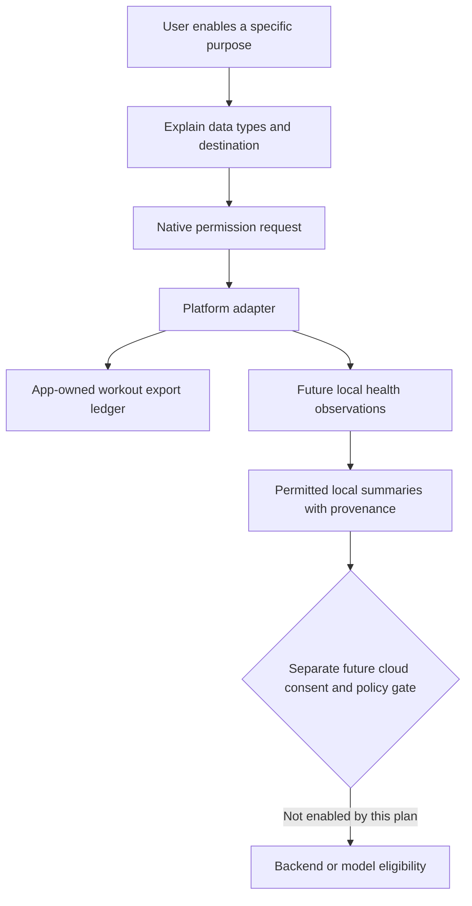

# Health and wearable integrations

Planning baseline: 2026-10-12. Health integration is optional product infrastructure, not a prerequisite for strength training. [PRODUCT.md](PRODUCT.md) and [ROADMAP.md](ROADMAP.md) determine availability; this document defines the later implementation boundaries.

## Scope by phase

| Stage | Included | Excluded |
| --- | --- | --- |
| MVP, Phases 0–1 | No health permissions, imports, exports, or wearable application | HealthKit/Health Connect dependency in workout logging |
| Phase 2, optional after core quality gates | Export completed Daily Motion workouts to the platform health store | Reading sleep, heart rate, body metrics, or external workouts |
| Phases 3–5 | Predictions and personalization based on collected training history and permitted manual observations | Assuming unavailable health signals exist |
| Phase 6 | Opt-in local health reads, measured recovery-context experiments, wearable exploration | Medical interpretation, compulsory health access, automatic cloud/LLM sharing |

A health-export switch does not authorize health reads. Platform permission does not authorize backend storage, global model training, or sharing with an AI provider. These require separate product-policy decisions, an ADR, explicit purpose-specific consent, and release qualification. The default for imported health data is **local only**, outside ordinary cloud sync, analytics telemetry, global training datasets, and assistant context.

Manual body measurements or readiness observations entered directly into Daily Motion are separate first-party records under [DATA_MODEL.md](DATA_MODEL.md). They do not imply OS health permission. Clinical records, reproductive data, medication records, location routes, and continuous sensor collection are outside the planned integration.

## Platform adapters and permissions

Use narrow Swift HealthKit and Kotlin Health Connect adapters behind the mobile health repository. A plugin may implement the bridge if maintenance, native API coverage, and migration behavior pass review; domain code must not depend on its platform-specific record classes.

Request only the types needed for the chosen feature, when the user activates it. No permission prompts during mandatory onboarding or while logging a set. Provide useful explanatory copy before the OS sheet, a settings entry, a clear disconnect action, and normal training behavior after refusal.

On iOS, verify HealthKit availability, add the capability and appropriate usage descriptions, and distinguish write authorization from read observability. HealthKit intentionally does not reveal whether read access was denied; an empty query is not proof of denial or absence. Do not display a fabricated permission status. [Apple HealthKit authorization](https://developer.apple.com/documentation/healthkit/authorizing-access-to-health-data)

On Android, check SDK/provider and feature availability at runtime. Health Connect is integrated into Android 14+, while older supported devices may require the Play-distributed provider. Availability still depends on device/profile support; Android version alone is insufficient. Daily Motion's Android 10+ floor does not guarantee Health Connect availability. [Health Connect availability](https://developer.android.com/health-and-fitness/health-connect/availability)

Future background reading and extended-history reading request additional permissions only after their specific value is established. Start with foreground refresh; handle history limits and feature checks instead of assuming unrestricted historical access. [Health Connect reading](https://developer.android.com/health-and-fitness/health-connect/read-data)

## Completed-workout export

Daily Motion remains the source of truth for sets, exercise identities, notes, and corrections. Export a strength-training workout summary containing start/end instants, duration supported by recorded timing, and platform activity classification. Never fabricate calories, heart rate, distance, or an energy expenditure estimate because a platform UI can display one. Detailed set logging stays in Daily Motion unless a later platform capability and user need justify exporting it.

Export only completed, cloud-accepted session revisions. Offline completion remains immediate; optional health export waits in its own local queue. It cannot block workout saving or normal sync. MVP does not contain this queue; it is introduced with Phase 2's export feature.

Each ledger entry records owner scope, Daily Motion session ID/revision, stable export identifier, platform record identifiers, attempted revision, acknowledged revision, state, and a sanitized error category. Persist intent before calling the OS API and acknowledgement afterward. A crash between those steps must retry without duplication.

Use HealthKit sync identifier/version metadata for app-owned objects and verify updates on physical devices. Use Health Connect `clientRecordId` and increasing `clientRecordVersion`; its returned record ID also belongs in the ledger. Do not use wall-clock time as the export version when the session revision is available. [HealthKit sync identifiers](https://developer.apple.com/documentation/healthkit/hkmetadatakeysyncidentifier), [Health Connect writes](https://developer.android.com/health-and-fitness/health-connect/write-data)

Enable export from one designated phone per account initially. Switching that phone requires an online, explicit setting change and advances an exporter generation. Before each native write, refresh active account, exporter generation and latest nondeleted completed-session revision; discard/supersede obsolete queued intents. If freshness cannot be checked, export waits while core logging continues. Reconcile again after acknowledgement; if deletion/correction/designation change raced the native write, queue a compensating app-owned update/deletion. Platform-local stores and their device synchronization are not equivalent to Daily Motion account sync. Do not promise duplicate suppression across unrelated health stores merely because identifiers match. Handover explains cleanup that may still be needed in the previous phone's store.

Corrections enqueue a replacement/update of the app's own exported summary at the new session revision. Permanent workout deletion enqueues deletion of known app-owned records and removes their personal ledger payload after completion. If permission/provider access prevents removal, show pending/manual-cleanup guidance rather than claiming success. Never delete by broad time range or alter records belonging to another source. See [Health Connect synchronization](https://developer.android.com/health-and-fitness/health-connect/sync-data).

External deletion of an exported record does not delete Daily Motion history. Do not continuously recreate a record the user removed in the health app; require an explicit re-export. Account deletion attempts local app-owned export cleanup before local credentials/ledger are removed, without claiming control of an inaccessible or offline device.

## Future local recovery context

Phase 6 may read bounded windows of sleep, resting/observed heart rate, external workouts, and body metrics where the feature has a defined benefit. Store source record ID, origin, device, units, time zone/offset, observed interval, source modification/version, import time, consent purpose, and quality/missingness flags. Retain only the recent window needed for the feature; initial default is 30 days for normalized local observations. Prefer derived summaries and avoid retaining high-frequency raw samples.

Do not mix device origins without provenance. Overlapping sleep intervals, overlapping workouts, different body-metric sources, daylight-saving changes, and sensor gaps need explicit handling. Apply platform aggregation where appropriate; imported records are not extra strength sets. Exclude Daily Motion's exports from imported-external-workout features to prevent feedback loops and double counting.

Read change feeds/anchors with pagination and idempotent local upserts. Apply source deletions as deletions, and rebuild the bounded window when a change token expires. Store platform cursors separately from Daily Motion's cloud sync cursor. No raw health record can be placed in the ordinary workout outbox accidentally.

Sleep duration and heart rate are imperfect context, not clinical readiness measurements. Display timestamps, coverage, and missing signals. Recommendations remain conservative and user-controlled; missing data reduces confidence rather than becoming a zero-valued feature. Evaluate any recovery model against the training-only baseline, including users without wearables, before claiming benefit. See [ML_ROADMAP.md](ML_ROADMAP.md) and [PREDICTION_ENGINE.md](PREDICTION_ENGINE.md).

## Consent, revocation, and lifecycle

Disconnect stops future reads/exports and clears relevant future local read caches/cursors. Permission revocation is not the same as erasing records already written to a platform store, local copies already retained, or existing cloud data under a separately approved future policy. Offer distinct erase controls and state what each can remove.

After revocation, fail gracefully and stop requesting the same permission repeatedly. Reconnection re-explains the purpose and rebuilds only the permitted bounded window. Sign-out locks the account-specific integration state; another account cannot export its workouts or manipulate its records. Ordinary account export clearly identifies first-party training data versus optional device-local imported observations.

HealthKit-derived data has specific usage and sharing restrictions. Daily Motion will not use health data for advertising or sell it, and will not route it to a generic AI provider by default. Recheck current platform policies and privacy disclosures before enabling either integration. [Apple health privacy requirements](https://developer.apple.com/documentation/healthkit/protecting-user-privacy)

Apple Watch, Wear OS, and supported third-party wearables are Phase 6 explorations, not implied extensions of the phone MVP. Start with a useful companion action such as viewing/logging a set; preserve device IDs, measurement provenance, deduplication, and battery limits. Live phone/watch editing requires a separate ownership/handoff protocol and ADR. Background synchronization remains best effort on both platforms.

## Qualification

Test actual devices with unavailable providers, partial permission, read ambiguity, locked phone, provider upgrade, app reinstall, duplicate retries, correction/deletion, revoked access, expired change tokens, account switch, and two phones. Confirm every case preserves the complete core workout flow. Test health caches are excluded from telemetry, assistant contexts, cloud sync, and backup. Integration release gates are part of [TESTING.md](TESTING.md), and privacy/security controls remain governed by [SECURITY.md](SECURITY.md).
