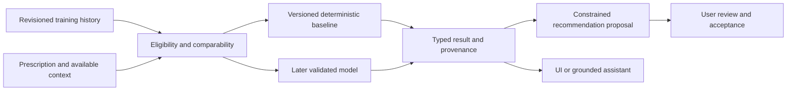

# Prediction engine

Status: planned; 2026-10-12. Introduced in Phase 3, after the offline logger and richer analytics. MVP records and displays training history without predictions. This document defines numerical behavior; [ML_ROADMAP.md](ML_ROADMAP.md) governs learning, [API.md](API.md) governs transport, and [DATA_MODEL.md](DATA_MODEL.md) governs historical truth.

## Responsibilities and boundaries

The engine returns supported numerical references or estimates and evidence. The recommendation domain turns those results into optional proposals. The assistant explains returned values; it cannot invent performance numbers, calculate its own substitute forecast, or bypass eligibility. A prediction is never a medical assessment, a measured personal record, or permission to increase load automatically.



Expected reps means observed reps under a specified prescription, not maximum capacity. Expected load requires a supported target and progression policy. Next-set performance is a separate horizon using only preceding observations. Session performance must define its outcome explicitly; planned workload is a reference, not a prediction of completed workload. Estimated strength remains a proxy. Fatigue and plateau outputs describe patterns in comparable performance, not diagnosed physiological causes.

## Inputs and comparability

Required inputs are a supported target/horizon, exercise variant and semantics version, equipment/load convention, prescription, known preceding history, and an input cutoff. Optional inputs include target/reported effort, actual rest, recent volume, readiness observations, and later consented recovery signals.

Preserve planned and actual values separately. Actual target-set RIR/RPE is unavailable before that set and cannot be a feature for its prediction. Recent volume excludes future sets and uses a compatible measurement policy. A server model sees acknowledged history only and captures its committed owner-feed fence with the feature read in one consistent snapshot. Acceptance timestamps explain timing but cannot substitute for commit visibility. Local deterministic calculations may see pending records and capture a consistent SQLite snapshot with per-root local sequences. See [SYNC_PROTOCOL.md](SYNC_PROTOCOL.md).

Comparability requires the same exercise variant, load and rep conventions, compatible equipment/setup, and relevant prescription context. Warm-ups do not become working-set references. Unilateral sides cannot be pooled when their recorded outcomes differ. Top/back-off work, deliberate deloads, and supersets retain their role and grouping. Observed completion sequence retains `order_source`; delayed entry is not proof of physical execution order and cannot support timing-dependent forecasts. Never fall back across vaguely similar exercises or invent an equivalent machine-stack load.

Time-based sets can support historical duration references; they are unsupported for rep-capacity and estimated-strength calculations. A zero-rep failed attempt is an observed outcome, not missing data. A skipped set has no outcome. A legitimate zero load is different from unknown load, bodyweight, or assistance.

Actual rest is measured only when an appropriate set-start or manual observation exists. An automatically measured gap between completed sets includes lifting time and is a proxy. Missing actual rest is not zero. Do not apply a fake rest adjustment or require an extra logging tap simply to fill a feature.

## Result contract

All consumers use one typed envelope. Outputs contain explicit units and supported metric names; unsupported outputs are omitted with reasons.

```json
{
  "prediction_id": "84f9d96f-7322-4e52-b44f-3566e1a3e184",
  "task": "expected_reps",
  "status": "reference",
  "method_version": "last-comparable-v1",
  "generated_at": "2026-10-12T13:12:00Z",
  "input_cutoff_at": "2026-10-12T13:11:58Z",
  "source_scope": "server",
  "visibility_cursor": "opaque-committed-owner-feed-fence",
  "source_revisions": [{"aggregate_id": "1051c381-c887-419a-9f51-814446d2472f", "revision": 8}],
  "evidence_count": 1,
  "missing_features": ["measured_rest"],
  "limitations": ["Historical reference, not a capacity forecast."],
  "interval": null,
  "outputs": {
    "reference_reps": {"value": 5, "unit": "reps"},
    "reference_load": {"value": "100.0", "unit": "kg", "basis": "total_external"}
  }
}
```

`status` is `reference`, `estimate`, or `unavailable`. An unavailable result has no invented numerical output. Metric names distinguish a reference from a forecast; all numerical outputs use typed value/unit structures. Local pending sources additionally include `local_seq` in `source_revisions` and have `visibility_cursor=null`; acknowledged server revision and local sequence are not interchangeable. Persistent prediction records retain this envelope and an exhaustive source/feature manifest with feature/catalog versions, or a referenced immutable manifest. Operational logs do not copy the feature payload.

Confidence is evidence, not an arbitrary percentage. Show count, recency, missing inputs, comparability, and method limitations. Deterministic references have no statistical interval. Learned intervals remain null until their coverage is evaluated on temporal holdouts; then the interval states its units, nominal coverage, and calibration version. Never label an uncalibrated range “90% confidence.”

## Versioned Phase 3 policies

**Last comparable exposure:** return the most recent eligible outcome as a reference. For a specified set position, use that position and compatible prescription; do not borrow a warm-up or unrelated back-off set. No history yields unavailable. An exposure older than 90 days remains a dated historical reference, with a stale-history limitation, and is ineligible for estimates or load increases.

**Median baseline:** with at least three comparable exposures within 90 days, estimate the median of the last three eligible observations for the requested supported outcome. A rep estimate requires the same normalized actual/requested load, loading basis, rep prescription, effort context, set purpose and position; do not interpolate or extrapolate to a new load. Different-load outcomes remain references showing their original load. Return provenance and recency. This predicts logged performance under comparable prescriptions; it does not establish rep capacity. Next-set estimates additionally require supported grouping and adequate timing context. Sparse grouping, unavailable actual rest, or unsupported methods return a reference or unavailable rather than an invented fatigue multiplier.

**Estimated strength:** for positive `total_external` free-weight working load with 2–10 completed reps in a curated eligible variant, the initial proxy is Epley: `load × (1 + reps / 30)`. No RIR adjustment is invented. Explain that submaximal effort limits interpretation. Initially exclude bodyweight-only, added-bodyweight, assistance, machine-stack, per-implement, warm-up, duration and multi-segment observations; their logged achievements/reference trends remain available. Do not apply the formula to a weighted pull-up's added load while ignoring body mass. One-rep load is a measured achievement, not evidence of maximal capacity. Keep this proxy separate from measured PRs and never invert it into an automatic maximal-attempt prescription.

**Double progression:** use an explicitly enabled/versioned progression policy, excluding deliberate deloads. Evaluate each same-load/rep-range prescription group separately, including separate top/back-off groups. Propose one available equipment increment after two comparable exposures where all prescribed working sets in that group meet their upper rep target, no failed/partial set exists, and actual RIR is at least target RIR or actual RPE is at most target RPE in the same recorded scale. Missing/mismatched effort or an unconfigured effort target yields repeat/rep guidance or abstention. Initially support positive total-external, per-implement and stable machine-stack load increases; bodyweight/assistance/unsupported methods remain reference-only. The initial configurable relative increase cap is 5%; if the smallest available increment exceeds it, do not issue a numeric increase. Zero/unknown reference load cannot pass the relative-load gate. This cap is a conservative product policy to validate, not a physiological guarantee.

**Possible plateau:** initial eligibility is four comparable exposures spanning at least 21 days, with stable prescription, an explicit progression goal/policy, comparable effort/adherence context, and no identified deload/setup change. Lack of improvement in prescription completion and supported performance proxies produces a possible-plateau observation with alternatives, not a causal diagnosis. Merely repeating a fixed submaximal prescription without attempted progression is unchanged training, not evidence of a plateau. Sparse, changing, or intentionally reduced training returns insufficient evidence. One bad session never proves a plateau or recovery problem.

## Evolution, failure behavior, and evaluation

First learned models forecast observed outcomes conditional on the prescription. Keep first-set, next-set, completion-probability, session, and progression targets separate. Never use actual reps in prescribed submaximal work as maximal-capacity labels. Intentional stopping, injury notes, or skipped sessions cannot silently become failure targets. Later fatigue-effect research can model conditional performance changes across set position and recent workload; these associations are not measured physiological fatigue or causal explanations.

Feature construction is as-of, not a latest-history join. Replay the committed feed visibility fence and source manifest, not timestamp-only filtering. Later corrections can create a new label revision; they cannot become earlier inputs. Whole-session temporal partitions, unseen-user tests, train-only preprocessing, and replayed visibility cutoffs protect evaluation. Model requests generated after an outcome are analytics and excluded from forecast scoring. See [ML_ROADMAP.md](ML_ROADMAP.md) for promotion and drift gates.

Fallback order is validated eligible model, supported deterministic estimate, historical reference, unavailable. Never retain a stale model output merely to avoid an empty state. Reject non-finite, negative, incompatible-unit, or method-bound-violating outputs rather than silently clamping them. Invalid inputs, changed schema, incompatible equipment, missing consent, deleted history, or unacknowledged server context trigger explicit limitations or abstention. Recheck the captured owner erasure epoch before storing/publishing derived payload so an in-flight inference cannot recreate deleted values. Repeated errors disable the affected method through a feature flag without disabling workout logging.

Server inference does not sit on the set-log path. Local Phase 3 deterministic rules run against Drift projections; Python and Dart share versioned golden fixtures and boundary expectations. No learned on-device inference is planned before a measured latency/privacy benefit justifies packaging and parity costs.

Acceptance requires fixtures for unit conversion, per-implement/unilateral conventions, zero/null/failure, optional effort, supersets, time-only sets, stale revisions, and edited history; causal replay tests; conservative progression boundaries; and model-versus-baseline regression checks. Explanations identify supporting observations and rule gates; later model attributions remain observational. Every displayed number must trace to eligible records or a registered method. See [TESTING.md](TESTING.md) and [DECISIONS.md](DECISIONS.md).
