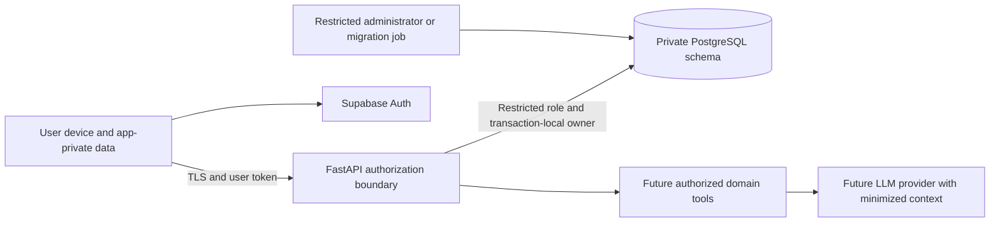

# Security and privacy

Planning baseline: 2026-10-12. This document is the retention and security-policy authority for the documentation package. Controls describe requirements for future implementation, not certifications or completed audits. See [ARCHITECTURE.md](ARCHITECTURE.md), [DATA_MODEL.md](DATA_MODEL.md), and [TESTING.md](TESTING.md).

## Trust boundaries and primary threats

Daily Motion contains private training history, notes, body measurements, and eventually sensitive recovery/health observations. Treat all user-provided IDs, timestamps, catalog names, notes, imports, and assistant messages as untrusted input. An authenticated mobile client is not a trusted database administrator.

| Threat | Required defense |
| --- | --- |
| Nested-ID manipulation or tenant crossover | Verified owner, composite owner-aware foreign keys, RLS, runtime-role tests |
| Replay, stale mutation, or deletion resurrection | Frozen idempotency envelopes, aggregate CAS, retired IDs, transactional receipts |
| Lost/borrowed phone | OS-protected storage, secure tokens, locked account state after explicit sign-out |
| Token/secret disclosure | Secret manager, redacted telemetry, least privilege, rotation procedures |
| Malicious notes/imports or LLM tool arguments | Data/instruction separation, typed tools, authorization and confirmation outside the LLM |
| Abuse of OTP/export/AI endpoints | Provider limits, server budgets, bounded payloads/jobs, monitoring |
| Deletion race or backup restoration | Immediate account disable, purge workflow, deletion ledger before restored access |

A compromised/rooted device can expose data the app legitimately needs while unlocked. The MVP does not claim resistance to that adversary. Update the threat model before health reads, wearable transfer, or high-value billing launch.

## Authentication and local access

Use Supabase email OTP for the account-required MVP; initial verification requires network access. Configure OTP emails explicitly, custom production SMTP, sender-domain authentication, resend throttling, verification attempt limits, and generic responses that avoid account enumeration. Never log email codes or place them in analytics. OTP-only sign-in avoids unnecessary social-provider linking and password-management scope. [Supabase passwordless email](https://supabase.com/docs/guides/auth/auth-email-passwordless), [Production SMTP](https://supabase.com/docs/guides/auth/auth-smtp)

Persist sessions through the Flutter SDK's supported secure-storage adapter, backed by iOS Keychain/Android protected key storage. Its default SharedPreferences persistence is not the intended token store. Keep project publishable identifiers distinct from privileged keys; no service/admin/database credential enters the app bundle. [Supabase Flutter session storage](https://github.com/supabase/supabase-flutter/blob/main/packages/supabase_flutter/README.md)

Local account ownership and cloud authorization are separate states. After first verified signup, access-token expiry or refresh failure pauses sync without blocking local routine creation, workout start/log/finish, or history. Explicit sign-out removes the cloud session and locks the account database; preserve unsynced work under that owner for authenticated recovery. Account switching never retags or uploads another owner's outbox. An authentication event handler must not erase history on transient failure.

FastAPI verifies allowed signature algorithms, issuer, audience, expiry, and subject with a maintained JWT library and trusted JWKS. Bound/cache keys responsibly and provide a cache-invalidation path for urgent rotation. A valid JWT is not sufficient when the application account is disabled. Sensitive account operations require recent authentication; session revocation checks are separate from signature validation. [Supabase signing keys](https://supabase.com/docs/guides/auth/signing-keys), [Session behavior](https://supabase.com/docs/guides/auth/sessions)

Remote sign-out, permission revocation, or account deletion cannot instantly wipe an offline phone. Enforce server denial immediately; apply local lock/erasure when the device receives the authoritative state. State this limitation plainly in product policy. Account deletion acquires the same owner guard as domain writes; mutations, ordinary job-effect publication and bootstrap publication recheck active state/generation under that guard to prevent previously authorized work committing after disable. Erasure workers are narrowly authorized to operate in `deleting` state for cleanup only, without recreating data. Never hold the guard across external network work.

## Authorization and database isolation

All training access goes through the domain API. Application training tables occupy a private schema that is not exposed through Supabase Data API access. Disable that API when unused, or deny all training-table grants/exposure. Do not maintain a parallel direct-write path that bypasses command validation.

The normal API role is non-owner with `NOBYPASSRLS`. Set tenant context using `SET LOCAL` inside each explicit transaction, derived solely from verified identity. Missing context fails closed. Repository queries filter owner explicitly; composite owner-aware foreign keys prevent a child from referencing another user's parent. RLS and grants are defense in depth, not a substitute for API authorization. Views/functions receive the same scrutiny as tables; privileged security-definer functions require review. [Supabase RLS guidance](https://supabase.com/docs/guides/database/postgres/row-level-security)

Migration/admin roles are separate, audited, and unavailable to request handlers. Background workers use narrow roles appropriate to their job; cross-owner deletion/export administration is explicit, not an excuse for unrestricted API credentials. Pooling tests verify transaction-local context is reset and cannot bleed between owners. Keep production dashboards and database consoles behind MFA and limited membership.

Authorization applies to nested session/set IDs, routine versions, snapshots, exports, predictions, conversation IDs, tool proposals, and job polling. Return sanitized errors; possession of an opaque identifier or signed artifact token alone never proves ownership.

The foundation now checks runtime-role metadata before every tenant transaction:
superuser/BYPASSRLS credentials, table-owner role membership or training tables
without enabled **and forced** RLS fail closed with a sanitized configuration
error. Actual PostgreSQL tests attack and restore each condition. This detects
unsafe deployment configuration; it is not protection against a malicious
database administrator. Database URLs/signing material are excluded from settings
representation. CI's credential guard reports only path/line/category, never the
matched token. Hosted grants, TLS and processor settings still need operator
qualification; see [the handoff](../infra/QUALIFICATION.md).

## Encryption, mobile controls, and API hardening

Require HTTPS for every external call and encrypted database connections with verified transport configuration. Managed PostgreSQL/storage encryption at rest must be confirmed in provider settings. Keep secrets in environment-specific secret managers, inject them at runtime, rotate SMTP/database/provider credentials, and scan commits/CI artifacts for leaks. Separate development, synthetic staging, and production projects and credentials.

MVP training data resides in OS-protected app-private SQLite; exclude the database, outbox, temporary exports, and auth state from automatic platform backups as appropriate. Verify exclusion on both platforms. This is not SQLCipher application-layer encryption. Do not mandate an extra native database stack without evidence; reconsider stronger local encryption and key lifecycle before storing imported native health data. Retain local access to pending work across process restarts without exposing it across accounts.

Hide private content from app-switcher previews where practical. Avoid sensitive notification text and clipboard persistence. Validate deep links strictly if future features introduce them. Certificate pinning is not required in MVP; ordinary platform trust plus a reliable rotation path is preferable to brittle pinning. Device attestation/root checks may inform abuse decisions later but cannot prove a trustworthy client.

Validate typed request bodies, sizes, enum values, owner references, and command schema versions. Bound sync batches, bootstrap snapshots, export size, conversation context, and job execution. Never concatenate user SQL. Apply per-user and per-IP budgets, stricter budgets for costly export/AI routes, and authentication-provider throttling. A per-process limiter alone is insufficient across autoscaled instances; use shared persisted budgets where needed. Limits must accommodate legitimate queued offline workouts and cannot block local logging.

Restrict storage objects by owner and use short-lived authenticated download paths. Do not log signed URLs. Audit dependencies and release signing; keep mobile signing keys and production deployment authority separate from untrusted PR jobs.

## Phase 0 development authentication boundary

The Oct 18 connection review found that a database-name suffix check could let
the destructive test fixture reach a remote host or another database. The fixture
now validates the parsed local target before engine creation and rejects query
and ambient libpq routing overrides. Separately, hosted API/operator validation
now shares a strict TLS query allowlist: additional parameters cannot replace the
confirmed host, database or role. SQLAlchemy's effective-host override was
reproduced without opening a connection; three fixture regressions and eight
initial hosted regressions fail before the fixes. Focused tests pass afterward.
The original `d655e1f` fix is now published with green remote CI. The subsequent
review closes inherited-port/database, multiple-host and startup-role-options
gaps; its full local regression uses a newly created disposable database.
An omitted port requires no `PGPORT` override; explicit ports retain precedence.
One host and an explicit database are required, and `PGOPTIONS` is rejected.
The follow-up remains local and **not deployed**; its publication/deployment
require authorization. No existing database was reset.
[Security and recovery evidence](evidence/phase0-recovery-and-connection-guards-2026-10-18.json).
[CI and follow-up review](evidence/phase0-ci-routing-review-2026-10-18.json).

The same review queries OSV with all 47 registry packages in the frozen Python
lock and 135 hosted Pub packages. It returns zero advisories, with all responses
present and no pending pagination. Known affected PyPI/Pub versions return 13/2
advisories as positive controls. This is a dated package-advisory check, excluding
native libraries, SDK internals and unknown/unreported issues; no dependency
version changed and no comprehensive security certification is claimed.

The requested hosted staging setup is documented in
[the Supabase/Render runbook](../infra/staging/README.md). Render holds only the
restricted runtime connection and synchronization signing key; migrations run
in a separate operator process. Staging/production runtime connections require
`sslmode=verify-full` and a trusted root certificate, HTTPS issuer/project agreement,
the authenticated audience and a publishable client key. The configured session
pooler uses port 5432; transaction-pooler compatibility is not silently assumed.
Readiness rejects unready grants/schema or privileged roles. Database errors are
sanitized and engine parameters hidden; provider/browser snapshots and real
`.env.*` are excluded from version control. Provisioning never prints passwords.
Hosted staging TLS/runtime/RLS setup is now verified separately in
[the evidence](IMPLEMENTATION.md); SMTP, real identity lifecycle and device
protection remain unqualified. Render
Singapore staging crosses regions relative to Supabase Mumbai under DM-018;
no India-only processing is claimed.

The staging operator now generates SCRAM-SHA-256 password verifiers with libpq
before executing role DDL. Plaintext passwords never enter that SQL, even when
the server default is MD5; real PostgreSQL creation/rotation/login tests audit the
driver boundary. Verifiers remain sensitive. Disable client SQL/exception output
and restrict provider logs; client parameter hiding alone cannot protect server
DDL logs. Earlier provisioning used plaintext password DDL. The bounded hosted
audit and affected staging credential rotation were performed on 2026-10-15,
including saved-secret read-back and fresh restricted-runtime verification. Two
legacy plaintext statements remain retained; neither historical purge nor
comprehensive log clearance is claimed. See [the operational evidence](IMPLEMENTATION.md).

The connected spike supports an explicitly configured **public** verification key
for a synthetic signed ES256 test issuer. Signature, issuer, audience, expiry and
subject validation still run; active-account checks and forced RLS still apply.
The local setup script alone has migration/admin authority. The API uses a separate
`NOSUPERUSER NOBYPASSRLS` runtime role. Mobile receives only a short-lived user JWT
and origin; no private signing key, database credential or service/admin secret.
Fixture/token flags are rejected in release builds. The API's public-key override
requires explicit `DM_ENVIRONMENT=development` or `test`; staging/production use
the trusted issuer's JWKS. This development path does not qualify hosted Supabase
delivery, provider revocation or native storage.

Foreground cycles freeze credentials through preflight/push/pull/bootstrap.
Successful responses are checked against the database's owner. Account-disable
errors carry a verified owner/version; mismatching/unbound responses cannot erase
another owner's database. A missing account record pauses sync as
`account_not_initialized`, not permanent erasure. Expired/invalid credentials keep
local training available. HTTPS is required outside explicit emulator/loopback
debug development; redirects do not forward credentials.

## Phase 0 authentication implementation boundary

The production-shaped path uses `supabase_flutter`'s supported SupabaseClient/Auth
API for email OTP, verification, refresh and local-scope provider logout. Each
bounded operation owns/disposes its SDK client. Automatic SDK refresh, URI login
and its default SharedPreferences session/PKCE persistence are not enabled.
Instead the account controller awaits the supported `LocalStorage` adapter and
uses a secure PKCE adapter. A serialized lifecycle and invalidation epoch fence
late verification/refresh results; they cannot persist credentials or unlock a
new account after sign-out. SDK auth logging is disabled, and application errors
expose safe codes without provider text, OTPs, tokens or authorization headers.
HTTP is restricted to the configured auth origin, rejects redirects and bounds
responses; disposable clients abort timed-out operations.

Both sessions and the minimal verified local-owner grant use
`flutter_secure_storage` 11.2.0. iOS requests non-synchronizing Keychain items with
`unlocked_this_device` accessibility; Android uses the package's protected-storage
defaults. Native bridge/option routing is desktop-tested; actual Keychain/Keystore,
reinstall, backup, lock-screen and hardware behavior remain device qualification.
Training databases remain OS-private SQLite, not independently encrypted by this
milestone. Android disables backup and excludes cloud/device-transfer domains.
iOS now guards and excludes the application-support directory before opening
SQLite, with native file protection. Windows static checks and Android emulator
package flags are configuration evidence; iOS compilation and physical backup,
restore, Keychain/Keystore protection and transfer behavior remain unqualified.

The protected owner grant restores only an existing matching, already-unlocked
database. Missing/corrupt cloud session material does not remove that grant or its
outbox. Missing/corrupt owner grants require verified sign-in; they never guess an
owner. Reauthentication unlocks only after verified API initialization. Explicit
sign-out writes a protected locked marker, drains the old coordinator, locks the
SQLite owner and removes session material. Either durable lock prevents a stale
cached session from reopening the database; storage failure reports attention.
Cloud logout can fail offline after local locking and is not misreported as a
confirmed provider revocation. Returning to the same account recovers pending
work; a different verified account opens its own UUID-scoped file and UI/domain
scope under the project's namespace.

Migration `0003` forces owner RLS on profiles and immutable account-retirement
markers. Runtime RLS allows retirement read/insert, with no update/delete policy.
The marker must be recorded before final account removal, under the same
initialization/retirement lock; restored-environment deletion-ledger replay remains
a separate operational gate. Matching-owner remote disable applies the existing
local erasure policy, including an already signed-out store. Ordinary auth errors
never invoke erasure. No new public erasure/export endpoint ships here.

Operators must configure separate projects, asymmetric signing/JWKS, confirmed
six-digit email OTP templates, custom SMTP, sender-domain SPF/DKIM, delivery monitoring and
provider resend/attempt limits. The UI's 60-second resend cooldown supplements
provider limits and is not an abuse-control replacement. Keep SMTP, service/admin
and signing secrets outside client-safe configuration. Actual hosted SMTP/OTP,
refresh, observable revoked-refresh denial and elapsed email-code expiry now
have desktop evidence. Urgent trusted-JWKS rotation remains unqualified and
requires operator authorization. See [the provider audit](evidence/phase0-provider-qualification-2026-10-18.json).

The Oct 18 audit also found a private Render Blueprint sync hook in a tool
response. It is absent from repository evidence, but remains exposed until
provider/operator invalidation is confirmed; no tool-log purge is claimed.
Source scanning now rejects Render deploy/sync hook credentials without printing
values. This guard does not invalidate an already disclosed credential.

**Later Oct 18 supported-control audit:** Auto Sync is verified disabled after
reload, while the hook is unchanged by private comparison. The Blueprint UI and
full published API expose no supported rotation/revocation or auth-only check.
Disconnection preserves resources but does not document hook revocation;
recreation can duplicate resources and adoption can apply configuration changes.
No hook request, disconnection, recreation, deployment or credential change was
performed. The same service remains Live on `c5d5414`; health/readiness return 200.
The saved Blueprint source still references the deleted branch, while the service
uses `main`. Incident status remains **OPEN** pending Render Support's server-side
invalidation and redacted non-triggering proof. Any fallback disconnection needs
owner approval plus confirmed revocation/migration semantics.
[Investigation and sources](evidence/phase0-render-hook-investigation-2026-10-18.json).

**Authorized Support submission:** private Render conversation
**215476446235862** accepted the request and the automated agent acknowledged
human escalation. Its initial service deploy-hook advice was challenged, not
applied. No human revocation confirmation or old-credential rejection proof has
arrived; incident status remains **OPEN**. The request contains no hook URL or
credential value and requires preserving services/database, enqueueing no sync or
deployment, and obtaining further approval for any resource modification.
No resource or credential changes were performed.
[Support evidence](evidence/phase0-render-support-submission-2026-10-18.json).

An already delivered recipient OTP message also passes SPF, DKIM and DMARC in
the receiving server's headers and Gmail's separate summary. Only classifications
and domains are retained; no raw headers, email address or code is recorded.
This qualifies sender authentication for that message, not future delivery or
daily capacity. [Header evidence](evidence/phase0-smtp-authentication-headers-2026-10-18.json).

## AI and health data boundaries

No AI or health integration ships in MVP. Future LLM context is minimized to authorized training facts required for the request; provider retention/training settings and subprocessors require documented review. Imported HealthKit/Health Connect data remains local by default and is excluded from cloud sync, global model datasets, and LLM context. Permission to read a device store does not authorize onward sharing. See [HEALTH_INTEGRATIONS.md](HEALTH_INTEGRATIONS.md).

The assistant never receives database credentials or executes arbitrary SQL. Typed tool handlers enforce ownership, quotas, current revisions, and allowed operations independently of the prompt. Future-plan changes require an explicit user confirmation bound to a proposal; active/historical workout commits are outside assistant authority. Untrusted retrieved text cannot change tool permissions or approval requirements. Numerical predictions originate from versioned prediction tools, with unavailable results handled explicitly. See [CHATBOT_ARCHITECTURE.md](CHATBOT_ARCHITECTURE.md).

Store only necessary tool audit metadata: action, proposal/confirmation identifiers, affected IDs/revisions, outcome, model/tool version, and timestamps. Do not retain duplicate full prompts or tool payloads in observability. Personal/global model eligibility requires its own purpose and consent policy; account deletion removes future training eligibility, without promising instantaneous model unlearning.

## Retention, deletion, and portability

| Data | Default policy |
| --- | --- |
| User-visible training projections | Retained for account use; correction preserves historical truth; deletion hides/excludes immediately |
| Personal payload in live stores and derived artifacts after permanent deletion | Purge target within 7 days; failures are tracked and retried |
| Redacted operational application logs | 30 days |
| Legally required security logs | Separate stream/retention after applicability review; never include workout payloads |
| Future conversation transcripts | Rolling 90 days; user may delete earlier |
| User-confirmed training preferences | Until user removes them or account erasure |
| Future device-local imported health cache | Bounded 30-day window by default; no ordinary cloud upload |
| Transient bootstrap snapshots | 15-minute token expiry; expired artifacts cleaned promptly |
| Minimal mutation receipts/retired UUIDs | Owner lifetime, without training/notes/health payloads |
| Backups | Expire within 35 days, subject to verified provider configuration before release |

Permanent deletion is an explicit product action; correction retention does not justify retaining deleted personal payload. Disable account access before enqueuing erasure. Remove current data, historical values, personal predictions/recommendations, conversations, confirmed memory, exports/snapshots, and derived/model-dataset eligibility. Redact deleted-root values from retained sync-feed bodies immediately while preserving cursor metadata, and invalidate existing bootstrap tokens before asynchronous page cleanup. Older cursors/tokens must not return erased values; transport copies are included in the seven-day live-store purge target. Keep only narrowly necessary deletion/receipt metadata, with separate legal-retention justification where applicable.

Permanent data deletion advances an owner `erasure_epoch` under the guard. Snapshot preparation, export/model jobs and assistant evidence capture it with their input snapshot and recheck before personal payload is stored/published. Reject/discard stale materialization even when the account remains active, preventing cleanup from being followed by a late reconstructed copy. Do not hold a DB lock through inference, OS calls or external storage; stage work privately and reconcile at publication. Already issued responses and offline copies cannot be recalled instantly.

Backups cannot be represented as instantly rewritten. Maintain a deletion ledger outside restored application snapshots; reapply it **before** users or jobs can access a restored environment. Verify actual backup expiry/restore controls against the stated 35-day ceiling. Existing trained global artifacts need an explicit retraining/removal policy before Phase 5; do not promise instantaneous unlearning.

Provide in-app account deletion and a machine-readable account export covering training history, routines/programs, units/provenance, and relevant corrections. Export authentication/authorization is enforced, files expire, and one owner's export never contains another's data. Device-local imported health observations are separately identified and included only through an explicit local export purpose. [Apple in-app account deletion](https://developer.apple.com/support/offering-account-deletion-in-your-app/)

## Governance and incident response

Before the India-first adult public release, review current applicable DPDP provisions and staged commencement, notices/consent, grievance/contact arrangements, deletion/export rights, subprocessors, and cross-border handling. Review CERT-In directions for actual entity/service applicability, incident reporting, and security-log obligations. Hosting in Mumbai is an operating default; it does not establish blanket residency compliance or replace this review. [MeitY rules and enforcement timeline](https://www.meity.gov.in/documents/act-and-policies/digital-personal-data-protection-rules-2025-gDOxUjMtQWa), [CERT-In directions and FAQs](https://www.cert-in.org.in/Directions70B.jsp)

Assign an incident owner and contact before launch. Maintain procedures for credential rotation, account disable, optional-service shutdown, evidence-preserving redacted security logs, provider escalation, required notification/reporting, and safe restoration. Run a tabletop and restore drill. Public release is blocked by unresolved tenant isolation, workout loss, secret exposure, or deletion defects; record security exceptions and review conditions in [DECISIONS.md](DECISIONS.md).
