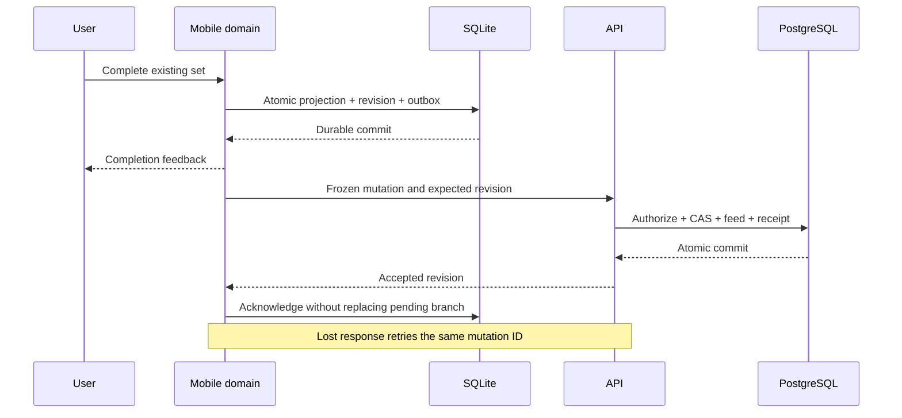

# Offline persistence and synchronization

Status: accepted planning baseline. Updated: 2026-10-12. Implementation and fault qualification are still required.

This document owns the synchronization protocol. Domain meanings are in [DATA_MODEL.md](DATA_MODEL.md); representative envelopes and errors are in [API.md](API.md). The design deliberately supports independent devices without promising simultaneous editing of one workout.

## Guarantees and boundaries

- Workout interactions succeed after an atomic local SQLite commit, never after a network round trip.
- A retry cannot create a second workout, exercise instance, set, or accepted mutation.
- A remote pull cannot overwrite a pending local change or silently resolve a meaningful conflict.
- Session completion, historical correction, substitution, reordering and deletion use the same revision boundary as ordinary set logging.
- First signup requires connectivity. After a verified account is cached, failed refresh or expired cloud tokens pause synchronization rather than local training.
- OS background execution, push delivery and network-reachability hints improve freshness; they are not correctness dependencies.
- There is no strict global single-active-workout invariant while offline. Enforce one active session per device and preserve independent session IDs.

The runtime stores an acknowledged server shadow, a working local projection, pending commands and a monotonic `local_seq` per aggregate. These are separate concepts. A local UI revision must never be passed off as a server-accepted revision. Installing changed clean server state also advances the local sequence used to invalidate previews; shadow-only updates do not rewrite a pending branch.

## Aggregate boundaries

Use one root revision for each workout session and each routine. Every session child mutation advances its root. Program publication later follows a program root revision with immutable published content. Profiles and private custom catalog resources have their own roots.

This intentionally makes disjoint changes to the same workout conflict across devices. It is simpler and safer for MVP than field merges, CRDTs or child-level optimistic concurrency. Command payloads still carry only necessary changes; editing a set does not upload the entire workout.

A session's prescription and exercise snapshots make it independently interpretable. Source routine/template/program IDs are optional lineage. A blocked routine upload must not block an otherwise valid session backup. Required new private catalog references may have explicit outbox dependencies; locally recorded work remains available while those synchronize.

## Local command transaction

1. Validate the action against the working projection and owner, including the shared serialized-command bound before accepting it. Existing set UUIDs and status checks prevent rapid double taps from recording a second set. Oversized edits retain their draft and explain the limit; they cannot strand an accepted outbox head.
2. Assign stable client UUIDs and a new mutation UUID. Record event time and provenance without using device time for conflict ordering.
3. Commit working changes, local observation revisions, `local_seq`, dependency information and an outbox entry in one SQLite transaction.
4. Render success and emit completion haptics after that commit. A storage failure keeps the set visibly uncommitted and offers retry without claiming success.
5. Attempt foreground sync when appropriate. A failed upload changes sync status, not workout status.

Pending numeric-editor drafts are also recoverable, but they are not completed performance observations. On relaunch, restore the active session and drafts before attempting cloud requests.

## Outbox and push

Each outbox entry records mutation ID, root ID/type, command, schema version, installation ID, local sequence, base revision, dependencies, immutable transport body after preparation, attempt count and delivery state.

- Send one eligible head command per root at a time. Independent roots can appear in the same bounded push batch.
- The first pending command retains the acknowledged revision on which the working branch originated. A creation expects revision zero and an unused ID.
- A dependent command obtains its expected revision from its **own predecessor's accepted receipt**, not whatever revision was most recently pulled.
- Freeze and persist the complete transport body before its first network send. Every retry uses identical content and mutation ID.
- Commands not yet prepared can retain local dependency metadata. Never change a previously sent envelope to disguise a conflict.
- Dependency cycles are invalid; failed/conflicted required dependencies pause their descendants. Independent roots continue.
- Use bounded exponential backoff with jitter. Retry timeouts and transient server failures; authentication failures await reauthentication; validation and revision conflicts require action.

If the server response is lost after commit, the receipt resolves the retry. If the app crashes before locally acknowledging that response, the same receipt resolves the next launch.

### Server acceptance transaction

Authenticate the request and establish owner context from verified credentials. Check application account state, not just JWT validity. Use a non-owner runtime DB role and tenant policies.

For each eligible command, one database transaction:

1. Locks the owner's sync-state row using a consistent lock order, then rechecks current account state and feed generation under that lock. Account deletion uses the same lock before disabling access. A pre-transaction authentication check alone cannot prevent a deletion race.
2. Checks the unique `(owner_id, mutation_id)` receipt and canonical request digest. Exact retries return the recorded acknowledgement; reuse with different content is rejected.
3. Checks ownership, retired IDs, root existence, expected revision and domain invariants.
4. Applies normalized projection changes, appends changed historical observations and advances the root revision once.
5. Advances the transactionally protected owner feed position and appends a complete atomic change batch.
6. Stores the acknowledgement receipt and any required durable derived-work job.
7. Commits all of these together.

Receipt metadata contains the request digest, result, affected IDs and accepted revision, not copied notes or set payloads. A duplicate receipt reports its historical acknowledgement; it does not assert that the entity has not subsequently changed or been deleted.

Every syncable owner-domain mutation path, including future assistant and administrative writes, uses this domain transaction. Internal receipt/job bookkeeping and prediction audit storage do not invent training changes or recursively enter prediction features. Jobs recheck purpose-appropriate owner state under the same guard before publishing effects: ordinary exports/derived results require `active`; narrowly authorized erasure cleanup permits `deleting` and cannot recreate payloads. Never hold that lock across external network work. Shared catalog publication has a separate version manifest; it does not fabricate user mutation feed entries.

## Commit-ordered pull

An opaque cursor binds account/feed generation and owner feed position. It is not a client timestamp or raw globally allocated sequence. Owner sync state also maintains an `erasure_epoch`, advanced under the owner guard on permanent data deletion. This invalidates in-flight materialization/derived publication without resetting ordinary feed ordering.

PostgreSQL sequence allocation does not follow transaction commit order. If transaction A reserves 100, transaction B commits 101, and A commits afterward, a cursor advanced to 101 could miss A. The owner row lock and transactional counter avoid that gap. [PostgreSQL sequence behavior](https://www.postgresql.org/docs/current/functions-sequence.html), [row locking](https://www.postgresql.org/docs/current/explicit-locking.html)

Return ordered, bounded pages of atomic root change batches with `next_cursor` and `has_more`. Never split one accepted command's changes across pages. If a batch exceeds the transport limit, return a typed capacity error and trigger an explicit supported snapshot path; do not truncate it.

On the client, persist the entire validated page and advance the cursor in the same SQLite transaction:

- Clean roots adopt the new shadow and working state.
- Roots with pending commands update only their shadow and conflict/freshness metadata. Preserve the working branch and its original base.
- Own mutation echoes reconcile with receipts; they are not external conflicts.
- A late acknowledgement never downgrades a newer shadow.

A future assistant confirmation may reserve only its affected future-plan roots. Treat those reservations like pending branches for pull installation until the authoritative commit outcome is reconciled. Active workouts and unrelated roots remain responsive. [CHATBOT_ARCHITECTURE.md](CHATBOT_ARCHITECTURE.md) defines the short local reservation transaction and timeout recovery.

Example: device A's command is accepted at revision 12; device B subsequently creates revision 13. A's queued next command still expects 12, even after pulling 13. It must conflict rather than silently rebase.

Sync after local commits, foreground/resume, successful login/refresh, and user retry. A network interface indication is only a hint; actual HTTP success determines connectivity. Drain bounded work while foregrounded, without blocking controls.

## Conflicts and recovery

A conflict returns the latest authorized root revision and a bounded description or reference to current state. Preserve local state, its base and pending branch. Pause uploads for that root, continue local logging, and display a recoverable sync issue outside the primary completion control.

The conflict screen shows server and local differences. Supported explicit resolutions are:

- Use server state after confirming what happens to local pending work.
- Apply reviewed local changes to the latest server state as new commands/mutation IDs.
- Preserve a workout branch as a new session with a new ID after user review, with linkage indicating an intentional copy.

No automatic last-write-wins, clock-based selection, or guessed merging of two measured outcomes. A resolution racing another device can conflict again without discarding either branch. A deleted server root cannot be resurrected under its retired ID; recovery creates a new ID.

Routine conflicts do not rewrite already started sessions. Historical corrections are explicit commands, not background repairs of the user's performance.

## Bootstrap and cursor expiry

Initial download, cursor expiry and feed-generation changes use a consistent bootstrap. Feed pages have a rolling 90-day transport retention default; historical workouts persist independently. Long-offline clients bootstrap rather than losing their outboxes.

1. In a short `REPEATABLE READ` transaction, read account generation, `erasure_epoch`, feed position `B` and all authorized current syncable projections.
2. Materialize immutable pages into private transient snapshot tables, then close the database transaction. Do not hold a transaction across HTTP requests.
3. Reacquire the owner guard and verify current account state, generation and captured `erasure_epoch` before publishing an owner-bound token containing version, `B`, expiry, page count and checksum metadata. A deletion during materialization invalidates publication even when the account remains active. Bind snapshot tokens/pages to that epoch; every page read checks current owner access and validity.
4. Authenticate every page request. Pages are immutable and can be retried independently.
5. Import into staging shadow tables. Validate every page and atomically activate the new shadow/cursor only when complete.
6. Preserve original pending bases, working projections, dependencies and local-only creations. Read their latest state during the activation transaction so logging that occurred during download is not lost.
7. Pull strictly after `B`.

Initial operating defaults are a 15-minute token expiry, approximately 512 KiB pages, a 64 MiB serialized snapshot ceiling and one in-progress snapshot per owner/device. These are bounded service policies, validated against a ten-year realistic history fixture and revisited from measurements. A capacity failure retains existing local state and returns actionable diagnostics; no silent historical truncation.

Expired or invalid incomplete snapshots discard staging data only. Snapshots contain current domain projections, not old correction payloads, model datasets, conversations or raw health reads. Ownership, deletion cascade and expiry cleanup apply to their temporary pages. [PostgreSQL transaction isolation](https://www.postgresql.org/docs/current/transaction-iso.html)

## Deletion, logout, and account lifecycle

An explicit permanent workout deletion checks its root revision, immediately removes its current projection/analytics eligibility, retires root and child IDs and emits a tombstone. Under the same acceptance guard, advance `erasure_epoch` and redact that root's personal values from older feed bodies while preserving feed positions/receipt metadata; mark those entries redacted for transport, not as old live observations. Invalidate existing owner bootstrap tokens and enqueue their page cleanup so an old snapshot cannot serve erased values. In-flight exports/predictions/assistant evidence carry their captured epoch and recheck it before storing/publishing derived payload; stale work is discarded/recomputed, not permitted to recreate erased copies. Personal values in revisions, materialized copies and dependent intelligence records enter the purge process defined in [SECURITY.md](SECURITY.md). Use private no-store transport responses; previously issued network responses cannot be recalled. Deleting an exercise instance through an ordinary historical correction retains correction history; permanent data erasure is distinct and clearly labeled.

Keep minimal receipts and retired IDs while the account exists, including after feed pruning. Updates never become creates, and creates cannot reuse retired IDs. Retention optimizations require an explicit device/generation expiry protocol before they may weaken these guarantees.

Explicit sign-out removes cloud credentials and locks the account's local database. Retain unsynced work under its original owner unless the user explicitly chooses permanent local removal. Another account cannot upload it. Reauthentication of the same identity resumes delivery; transient refresh failures do not emulate sign-out.

Account deletion takes the owner guard, disables cloud mutation/bootstrap immediately, cancels jobs and then purges owner payloads and metadata. Backend initialization cannot recreate an erased account from an old still-valid JWT: it must verify current provider identity and deletion/revocation state. Retain only necessary short-lived revocation markers according to the security policy. Restore-time deletion suppression is maintained outside restored application snapshots.

An offline device cannot be instantly revoked or remotely erased. On its next authenticated contact, apply deletion state before upload. Never promise device erasure without contact. A user creating a genuinely new account receives a new owner identity; old pending data is not automatically transferred.

## Timers and background work

Rest timers use persisted local anchors/deadlines and elapsed monotonic time when reliable. Restore from wall-clock anchors after process loss, marking uncertain observations after clock changes, reboot or delayed entry. The display is a projection; neither periodic ticks nor a server timer are historical measurement sources.

Notification denial, device lock, Doze, app termination or unavailable background refresh must not corrupt logging or timer state. Notifications are best-effort reminders. Foreground restoration corrects the countdown from its anchors. [Apple scheduling limits](https://developer.apple.com/documentation/backgroundtasks/bgtaskrequest/earliestbegindate), [Android background work](https://developer.android.com/develop/background-work)

## Compatibility, monitoring, and qualification

Version command schemas and support the current and previous released mobile contract during rollout. Reject unsupported cloud commands with a typed upgrade error while preserving local work and export access. Test local migration of active sessions, drafts and frozen outbox bodies. Server additive rollout precedes clients; destructive cleanup waits until compatible migration and recovery paths exist. A command is bounded to 256 KiB in the shared canonical UTF-8 representation; adapt batch packing to the 1 MiB request limit. Incremental exercise/set commands support long free workouts without an unbounded creation blob.

Monitor oldest pending age, conflicts, retry categories, idempotency digest mismatches, bootstrap failures and owner-lock contention without logging workout payloads. Background freshness is not an SLA. Logging responsiveness is independently qualified on real devices.

Required fault scenarios include process loss at every commit/ack boundary, duplicate/reordered delivery, disjoint edits, completion racing a child change, late own acknowledgements, deletion with stale creates, bootstrap during logging, expired snapshots, authentication loss, account switching and cursor reset. [TESTING.md](TESTING.md) defines release qualification; these guarantees must be demonstrated before the first public release.
