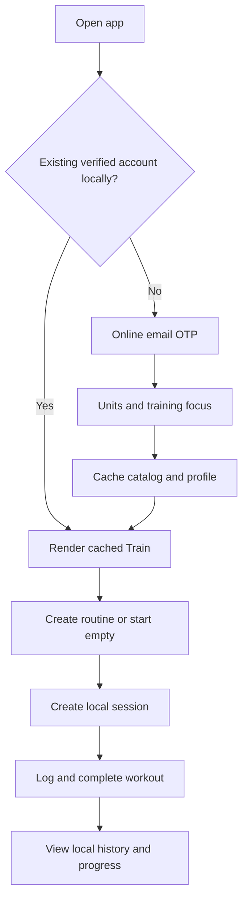
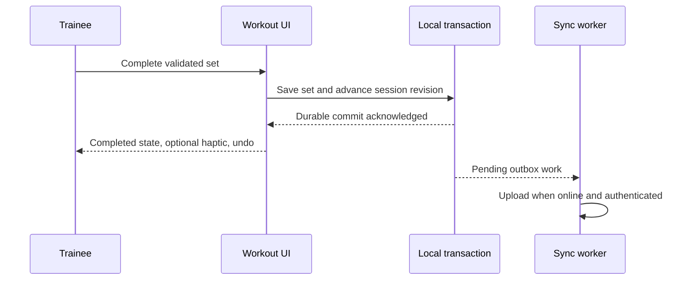
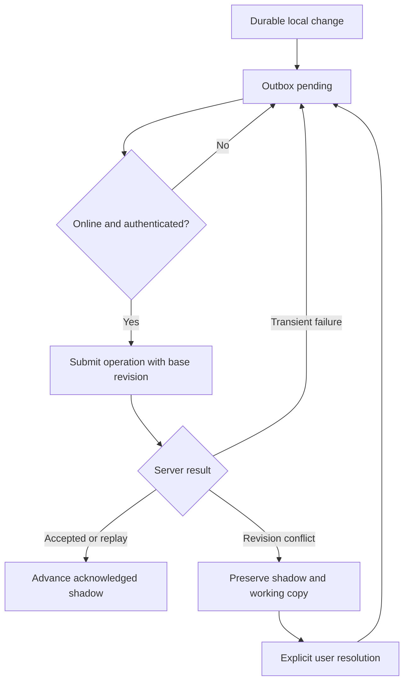

# Daily Motion user flows

Planning baseline: 2026-10-12. These flows distinguish launch behavior from later capabilities. [DATA_MODEL.md](DATA_MODEL.md) owns entity vocabulary, [SYNC_PROTOCOL.md](SYNC_PROTOCOL.md) owns revisions/conflicts, and [DESIGN_SYSTEM.md](DESIGN_SYSTEM.md) owns interaction presentation.

## Onboarding, account creation and first workout — MVP

The initial launch presents a concise training proposition, adult eligibility and sign-in/create-account. An account is required; there is no guest workout path. Email OTP verification requires connectivity. Explain the connection requirement before the user starts. Do not present social-login buttons, AI setup, recovery permissions or billing during MVP onboarding.

After verification, select kg/lb and strength/hypertrophy focus, with kg as the India-first default. Explain load conventions when the relevant exercise first appears, not through a long tutorial. Catalog and initial profile data are cached. Offer “Create a routine” and “Start empty workout.” Selecting exercises and target sets can establish a small first routine; the user can save and start it. Avoid a blocking questionnaire or a promise of a personalized program.

An existing user's expired token prompts unobtrusive reauthentication for sync; it does not lock cached training. Account recovery/new-device setup is online. Local stores are account-scoped, and signing into another account must not expose or reassign pending records. See [SECURITY.md](SECURITY.md).

## Routine creation and workout start — MVP

Create/name a routine, choose catalog or custom exercise variants, arrange their order, enter target sets/reps/load/effort as desired, and configure planned rest. Targets are optional where appropriate and are never performed observations. Custom variants require enough equipment/load/rep convention to make subsequent history intelligible. Group selected exercises into a simple superset and preview the round order.

Saving advances the routine root and publishes immutable workout-template content when content changes. Editing a routine affects future starts; an active or completed session keeps its self-contained start-time snapshot. Optional source IDs record lineage and do not prevent session sync when the routine itself conflicts. A routine may be archived without hiding workouts performed from it.

Start creates a device-generated session ID and snapshots the routine's current content. Check for an active session on this device first: resume it, finish it or explicitly abandon it. Independent devices may create independent session IDs; MVP provides no live handoff of one session. An empty workout starts with no exercise observations. Resolve catalog/history context locally; network availability is not a start condition for cached content.

## Set entry, editing and rest — MVP

Each exercise shows previous comparable results and current planned/draft sets. The user enters load, reps and optionally effort, then deliberately records the outcome. Warm-up/working class and regular/top/back-off purpose are separate controls. Choose either RIR (0–10; 10 is coarse high reserve) or RPE (1–10, half steps); preserve the observed scale rather than treating one as a lossless conversion. Load and reps explicitly follow total/per-implement/per-side conventions. Holds/carries use supported duration/distance fields. A completed repetition set has positive reps; a failed attempted set may have zero. Pending, partial, failed and skipped outcomes remain distinct; blank values are not failed attempts.

Duplicating a set creates an editable draft, not another completed observation. Editing a recorded set saves a correction revision, identifies the correction in history and invalidates affected derived records without reactivating a completed/abandoned session. Undo uses the same correction path. A local-storage failure retains the draft and offers retry; a network failure retains the committed result and pending state. Incomplete form drafts recover after interruption without becoming training outcomes. Completion sequence describes observed logger order with provenance, not guaranteed physical execution order after delayed logging.

On completion, the planned rest timer starts if enabled. Adjust/skip/cancel from the visible timer control. A superset advances to the next group member and starts group rest after the round's designated last exercise; a skipped member does not create an actual set. Notifications are requested only when the user enables reminders. Denial leaves the visible timer usable. App resume recomputes remaining time from persisted timer state. Completion-to-completion gaps are not displayed or trained as measured actual rest unless a start/manual observation exists.

## Substitution, completion and abandonment — MVP

Open the normal exercise picker from the exercise menu, choose a compatible or custom replacement, and review what will change. The active session retains the intended exercise and records the replacement relationship. Existing sets stay associated with the exercise actually performed. The user separately decides whether to update the reusable routine; an in-session substitution does not silently alter it. Automated substitution ranking is future work.

Finish shows recorded sets, skipped/uncompleted content, session duration and notes. Require explicit finish and at least one attempted/performed set; an empty session offers continue, abandon or explicit discard instead of a completed workout. Do not mark drafts complete. Persist completion locally and show a summary even offline. A session may cross midnight; group/display by its recorded local context rather than splitting it. A temporary pause records interruption when explicitly used; app backgrounding alone is not proof of a training pause.

Abandon confirms that the session was not completed and retains its actual recorded work/history state according to domain policy. Permanent workout deletion is a separate explicit action. Historical corrections preserve provenance; permanent deletion removes payloads and affected derived eligibility, with minimal sync tombstones preventing restoration by stale devices. Do not call archive, abandonment and permanent deletion interchangeable.

## History, exercise history and progress — MVP

History defaults to cached completed sessions newest first, with an abandoned-session filter, date, routine/name and a factual summary. Open a session to inspect actual exercise/set details, notes and corrections. Locate exercise history from catalog search, the workout screen or Progress. Comparison is limited to compatible variants, equipment/load basis and rep conventions. A catalog rename or routine edit does not change what the session originally recorded.

Progress exposes observed load/repetition trends and measured records, with date filters and clear units. Switching display units changes presentation, not canonical observations or original units. Warm-ups, invalid drafts and deleted outcomes do not enter working-set summaries. No estimated strength, readiness score or prediction appears at launch. Charts provide textual/data-list alternatives. Permanent deletion and corrections refresh affected local summaries and later server projections.

## Programs and imported history — Phase 2

A program organizes versioned workout templates over multiple weeks. Create/edit a draft, review the changed future schedule and publish a new version. Completed sessions retain the program/template version from which they started; missed sessions remain missed unless the user explicitly reschedules them. The initial program UI does not automatically optimize progression or recover missed weeks.

CSV import presents mapping, unit/load conventions and a validation preview. Uncertain rows require correction or exclusion. Repeating an import must not duplicate prior imported observations. Imported history carries source/quality provenance and is not automatically eligible for ML features requiring timing/effort information. See [API.md](API.md) and [ML_ROADMAP.md](ML_ROADMAP.md).

Optional manual body measurements are entered from Progress/settings with measurement time and units; they are not required for a workout or interpreted as native health imports. Phase 5 can offer an optional first-party readiness check before training, with missing/skipped responses preserved as unknown. No such check blocks starting or logging a session.

## Assistant and recommendations — Phases 3–4

Phase 3 surfaces deterministic references/estimates and proposals only where the underlying service can provide source records, method/version and limitations. Statistical uncertainty is absent until calibrated. Accept/reject is explicit; ignoring a suggestion is not acceptance. Record exposure and decision separately, and do not turn acceptance into proof of outcome improvement.

Phase 4 adds contextual assistant entry from Train, History and Progress. A query retrieves authorized training evidence through domain tools. Show source links and data recency, especially when server history lacks pending local edits. Numerical predictions must reference a prediction-engine result; insufficient evidence produces an honest unavailable answer.

Assistant writes are limited to confirmed **future** routine/program changes. Display the exact affected targets, before/after changes and base revision. Confirmation applies that proposal through the normal domain interface; a stale revision requires refresh and renewed review. The assistant cannot complete/edit historical sets, manipulate an active workout or apply substitutions through a hidden write. “Replace this exercise” opens the normal picker. Offline chat explains unavailability while training continues. See [CHATBOT_ARCHITECTURE.md](CHATBOT_ARCHITECTURE.md).

## Health permissions — Phase 2 export; Phase 6 recovery

After a completed workout or from settings, offer optional health-store export with a purpose explanation, then request only necessary write permission. Export waits for cloud acceptance of the completed session revision and runs from one designated phone per account; offline completion stays immediate. Changing the export phone is an explicit online setting change. Export failure queues a retry and never reverses workout completion. Do not estimate unmeasured calories or export imported records. Later sleep/body-mass/heart-rate reads require separate feature-specific explanations and permissions; health-store permission does not authorize LLM disclosure or global model training.

HealthKit empty results cannot establish denial; Health Connect availability, feature flags and permission coverage vary. Display missing/unavailable data without interpreting it as low readiness. Revocation stops access; provide a separate imported-data removal flow and explain the treatment of existing external exports. [HealthKit authorization](https://developer.apple.com/documentation/healthkit/authorizing-access-to-health-data), [Health Connect availability](https://developer.android.com/health-and-fitness/health-connect/availability). Details belong in [HEALTH_INTEGRATIONS.md](HEALTH_INTEGRATIONS.md).

## Offline operation and synchronization conflicts — MVP

Cached routine edits, workouts, corrections and history operate offline after initial account verification. Show compact “saved on this device/pending sync” status. Expired authentication pauses upload; retry after OTP reauthentication using the same record identities. Do not discard pending work on timeout or change its owner. Sign-out explicitly locks and retains the owner database, including pending work, and explains how returning to that account restores it. Another account cannot access it. Local permanent erasure is a separate deliberate action, never automatic cleanup of a network error.

Sync uses aggregate revisions and compare-and-swap, not timestamps or last-write-wins. Any workout-child change advances the session root. If a remote aggregate changed from the local acknowledged base, preserve the remote shadow and local working copy. The conflict screen shows both, identifies the affected routine/workout and lets the user resolve through the protocol's explicit path. Retaining conflicting work as a separate recovered workout requires a new ID and clear provenance; never duplicate implicitly. Conflicts on one record must not stop independent records from syncing.

When account/workout deletion is confirmed, retire relevant identifiers and apply the deletion protocol; an old offline device must not resurrect records. Remote permanent account deletion requires connectivity and reauthentication. Explain device-local and backup retention accurately rather than promising immediate physical erasure everywhere.
